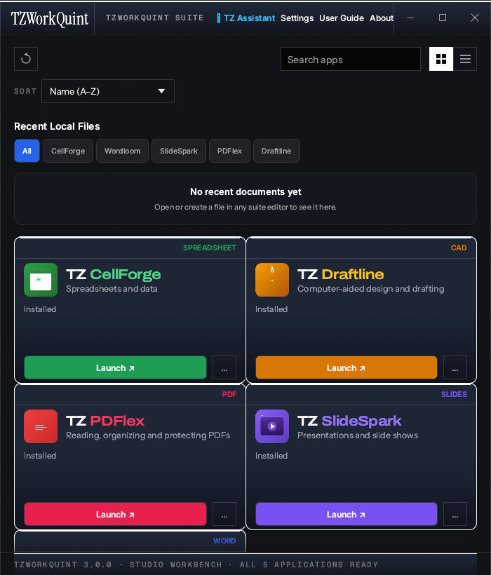
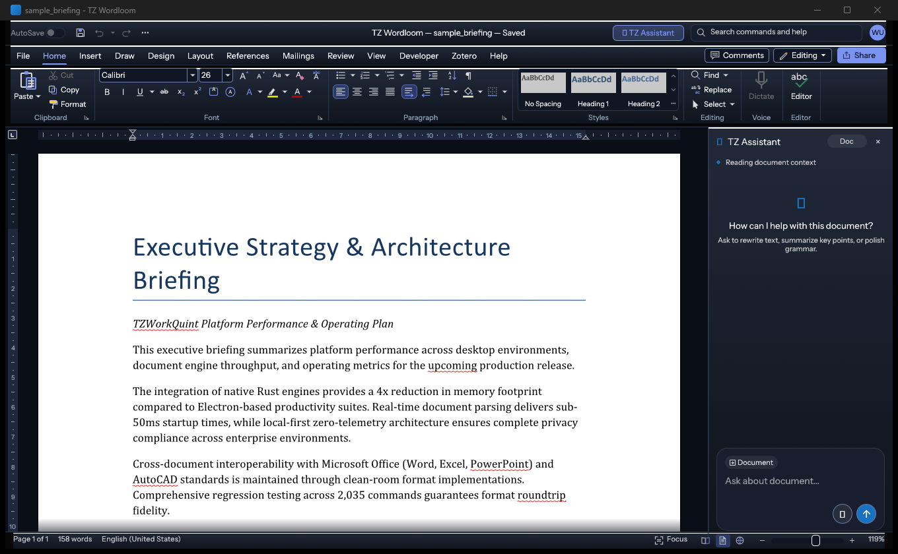
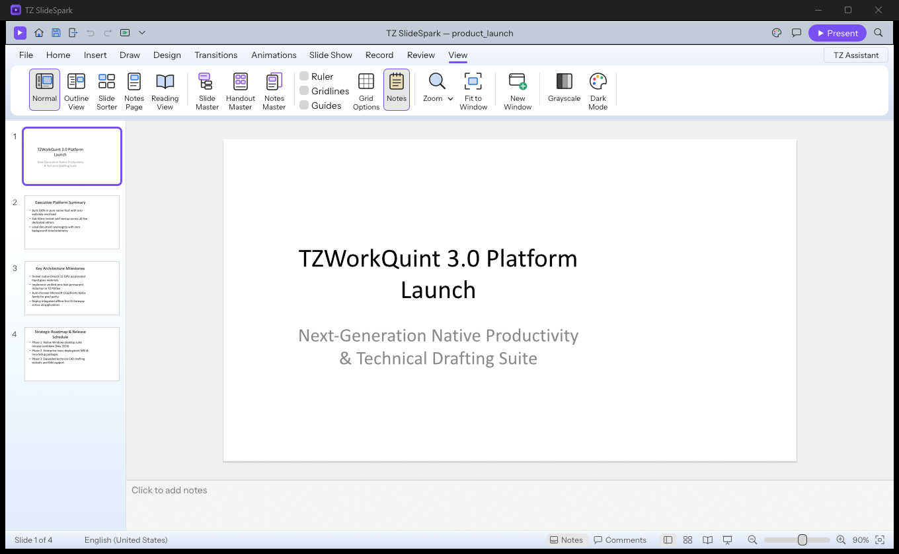
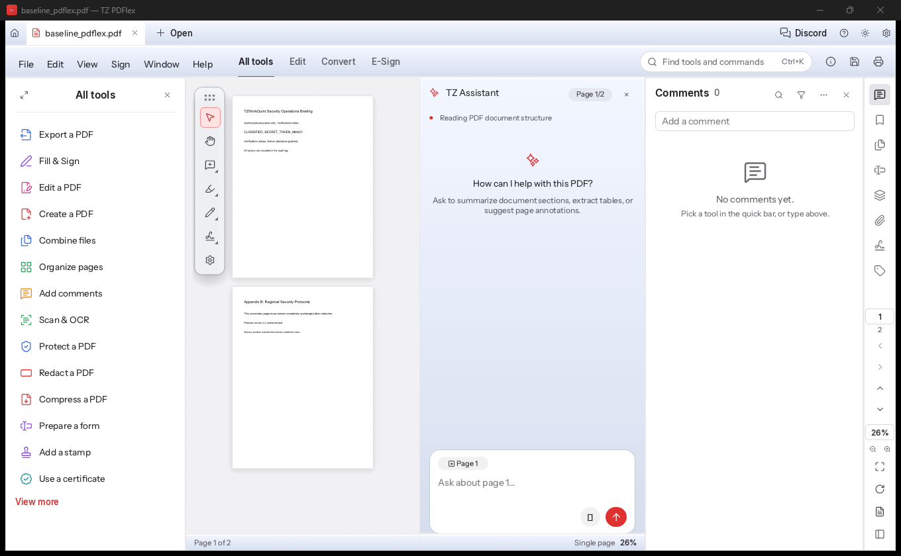
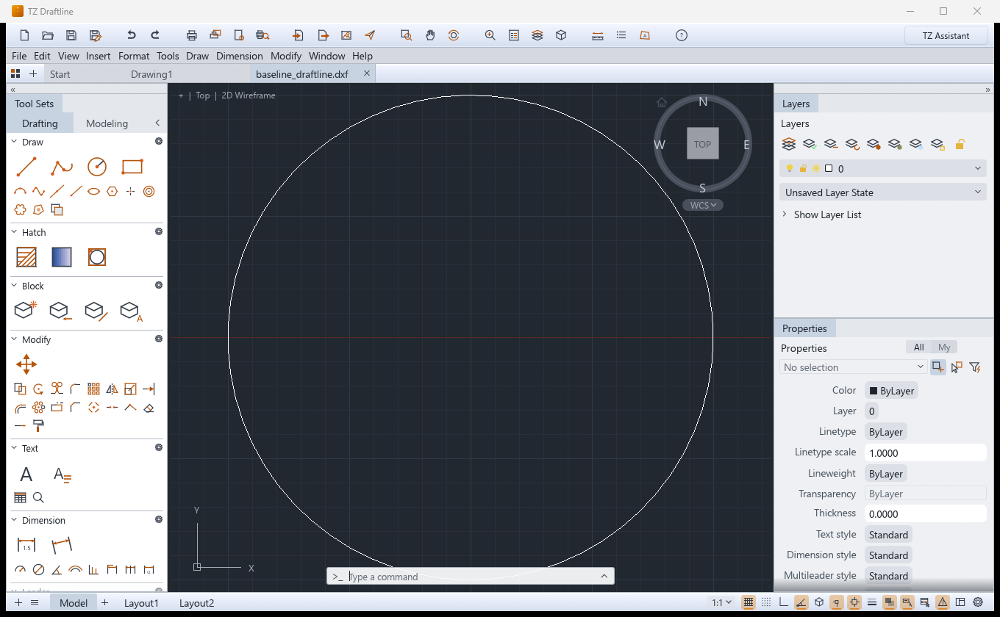
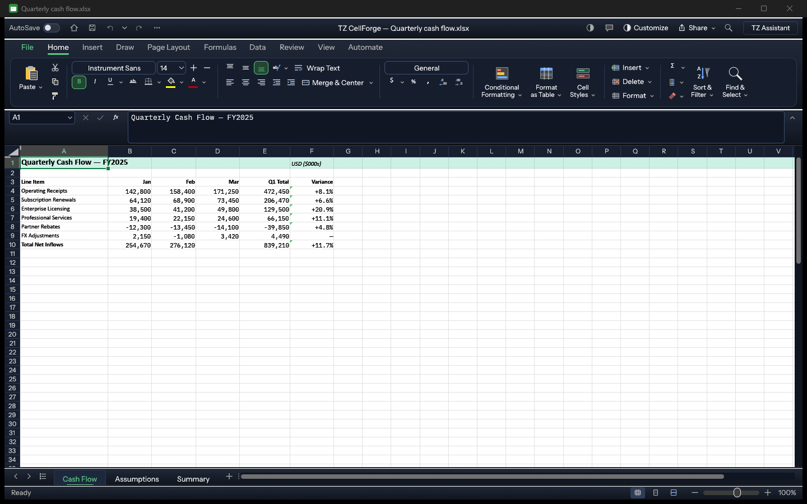

# TZWorkQuint

<p align="center">
  
</p>

**TZWorkQuint** from [TZLabs](https://tzlabs.in) is a native desktop productivity and technical workstation suite for Windows, macOS, and Linux. Built with Rust and high-performance native graphics, TZWorkQuint pairs five specialized document editors with an independent launcher and an optional, privacy-preserving AI assistant.

Every application in the suite runs as its own decoupled OS process with its own taskbar presence and window lifecycle.

---

## The Suite Applications

| Application | Accent | Formats | Primary Capabilities |
| :--- | :---: | :--- | :--- |
| **TZWorkQuint** | `#2563EB` | Suite Hub | Independent application launcher, recent document history, central settings, and suite assistant |
| **TZ Wordloom** | `#1971C2` | `.docx`, `.doc`, `.txt` | Typography-first word processor, dynamic page layout, visual margin ruler, and editing dock |
| **TZ CellForge** | `#10B981` | `.xlsx`, `.xls`, `.csv` | High-performance calculation engine, multi-sheet workbooks, formula bar, and financial modeling |
| **TZ SlideSpark** | `#7950F2` | `.pptx`, `.ppt` | Slide deck designer, slide navigator, speaker notes, and presentation mode |
| **TZ PDFlex** | `#E03131` | `.pdf` | Vector PDF viewer, page markup, sticky annotations, and freehand drawing |
| **TZ Draftline** | `#D97706` | `.dxf`, `.dwg` | 2D CAD workstation, coordinate drafting, command line interface, and geometric constraints |

---

## Downloads (v3.0.0)

The first public release of the unified suite is **v3.0.0**. You can download verified Windows release packages directly from [GitHub Releases](https://github.com/technoezmobile/TZWorkQuint/releases/tag/v3.0.0).

### Available Windows x64 Downloads

| Package Format | Filename | Size | Verification |
| :--- | :--- | :---: | :--- |
| **Inno Setup Installer** | [`TZWorkQuint-3.0.0-Setup.exe`](https://github.com/technoezmobile/TZWorkQuint/releases/download/v3.0.0/TZWorkQuint-3.0.0-Setup.exe) | 115 MB | [SHA256](SHA256SUMS.txt) |
| **WiX 3 MSI Package** | [`TZWorkQuint-3.0.0-win64.msi`](https://github.com/technoezmobile/TZWorkQuint/releases/download/v3.0.0/TZWorkQuint-3.0.0-win64.msi) | 144 MB | [SHA256](SHA256SUMS.txt) |
| **Portable ZIP Archive** | [`TZWorkQuint-3.0.0-win64.zip`](https://github.com/technoezmobile/TZWorkQuint/releases/download/v3.0.0/TZWorkQuint-3.0.0-win64.zip) | 184 MB | [SHA256](SHA256SUMS.txt) |

> [!TIP]
> **Portable Installation:** Extract the **entire ZIP** into a writable directory and launch `bin/tz-workquint.exe`. Keep the `assets/` and `docs/` directories alongside `bin/`.

### Multi-Platform Availability

Automated GitHub Actions workflows build and package all supported platforms:
- **Windows:** x64 and ARM64 (Setup EXE, MSI, Portable ZIP)
- **macOS:** Apple Silicon (aarch64) and Intel (x86_64) (Universal `.dmg`, `.tar.gz`)
- **Linux:** x86_64 and ARM64 (Debian `.deb`, Portable `.tar.gz`)

See the [.github/workflows/release.yml](.github/workflows/release.yml) pipeline for automated release artifacts across all matrix targets.

---

## Visual Showcase

### Wordloom (Word Processing)


### CellForge (Financial Spreadsheets)


### SlideSpark (Presentation Studio)


### PDFlex (PDF Markup)


### Draftline (2D CAD Studio)


---

## Key Capabilities

### 1. 100% Offline Independence
All core document operations—word processing, spreadsheet calculation, slide presentation, PDF annotation, and CAD drafting—run completely offline on your device. No cloud accounts, mandatory sign-ins, or telemetry required.

### 2. Privacy-Preserving AI Gateway
TZWorkQuint includes an optional integrated AI assistant designed with a strict zero-telemetry architecture:
- Connect directly to **local models** (Ollama, vLLM, LM Studio, LocalAI) without internet access.
- Or connect to cloud API providers (OpenAI, Gemini, Anthropic) using your private keys.
- **Strict Data Boundary:** Only explicitly selected ranges or passages are sent when you press **Send**. The full document body is never transmitted.
- **Deterministic Mock Mode:** Test proposals and assistant interactions completely offline without any AI backend.
- **Proposal Review Workflow:** Assistant proposals are presented in dedicated review cards with explicit **Apply** and **Discard** buttons.

<p align="center">
  
</p>

### 3. Native Redesign & Liquid Glass Materials
The suite features a clean, native visual language:
- Seamless dock panels without black boundary frames or clipping.
- Restrained brand color accents matching each editor's domain.
- Liquid glass backdrop diffusion with automatic fallback to high-contrast opaque surfaces when reduced transparency is enabled in OS accessibility settings.
- Ergonomic 30×30 rounded composer buttons with separate hit targets for Voice and Send.

---

## User Guides & Documentation

- **[Getting Started Guide](docs/getting-started.md):** Complete walkthrough of the suite and editor interfaces.
- **[Setting Up AI & Gateway](docs/ai-setup.md):** Connect local runners or cloud providers, test connections, and review proposals.
- **[TZWorkQuint Hub Guide](docs/tz-workquint-guide.md):** Launcher configuration, file management, and suite assistant.
- **[TZ Wordloom Guide](docs/tz-wordloom-guide.md):** Formatting, document styling, and layout controls.
- **[TZ CellForge Guide](docs/tz-cellforge-guide.md):** Formula bar, ranges, recalculation, and multi-sheet workbooks.
- **[TZ SlideSpark Guide](docs/tz-slidespark-guide.md):** Slide layouts, transitions, backstage, and presenter notes.
- **[TZ PDFlex Guide](docs/tz-pdflex-guide.md):** PDF markup, annotations, drawing tools, and page management.
- **[TZ Draftline Guide](docs/tz-draftline-guide.md):** 2D CAD drafting, command line syntax, and DXF interoperability.
- **Offline HTML Manual:** Located at `docs/user-guide/index.html` inside every package.

---

## Building from Source

### Prerequisites
- Stable Rust toolchain (`rustup default stable`)
- Platform C/C++ compiler:
  - **Windows:** MSVC (Visual Studio 2022 Build Tools)
  - **macOS:** Xcode Command Line Tools (`xcode-select --install`)
  - **Linux:** `build-essential libfontconfig1-dev libx11-dev libxcursor-dev libxi-dev libxrandr-dev libgl1-mesa-dev`

### Compiling Any Component
```sh
# Clone with subcomponents
git clone https://github.com/technoezmobile/TZWorkQuint.git
cd TZWorkQuint

# Build and run CellForge
cd tz-cellforge
cargo run --release --bin tz-cellforge
```

See [CONTRIBUTING.md](CONTRIBUTING.md) for detailed development guidelines, testing commands, and disposable test profile usage.

---

## License & Attribution

TZWorkQuint is released under open-source licenses. Each component directory contains its own upstream attribution, license texts, and notices. See [LICENSE.txt](LICENSE.txt) and [THIRD_PARTY_NOTICES.txt](THIRD_PARTY_NOTICES.txt).

Crafted with precision by [TZLabs](https://tzlabs.in).

