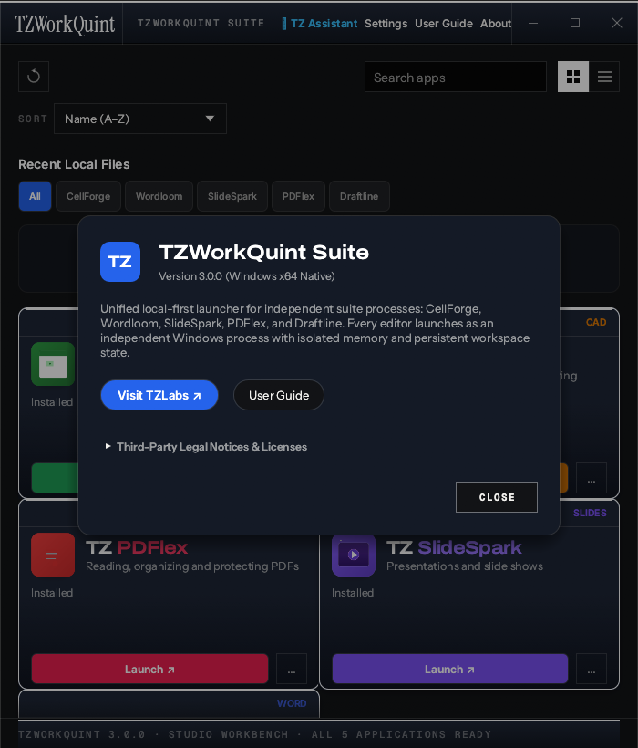
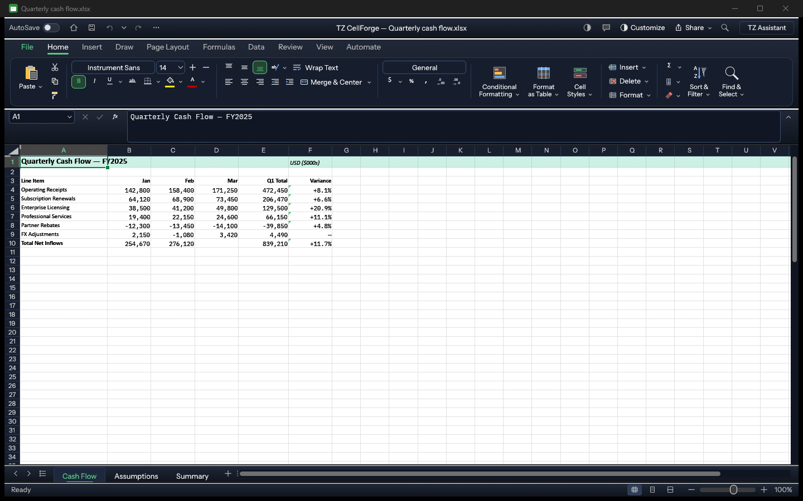

# Setting Up TZ Assistant & AI Gateway

TZWorkQuint includes an optional integrated AI assistant designed for contextual assistance, formulas, document review, and drafting. 

> [!IMPORTANT]
> **Complete Offline Independence:** Ordinary editing, spreadsheet calculation, slide presentation, PDF annotation, and 2D CAD drafting work **100% offline** without any network connection, account, or external API key. AI inference is strictly opt-in.

---

## 1. How TZ Assistant Works

TZ Assistant is built on an open, privacy-preserving gateway architecture:
- **Local-First & Direct:** You can connect to a local LLM runner (such as Ollama, vLLM, LM Studio, or LocalAI) or a remote OpenAI-compatible / Gemini / Anthropic API endpoint.
- **Zero Background Telemetry:** The suite never scrapes your documents in the background. The assistant only inspects what you explicitly select (e.g., cell range `D4:D9` or a highlighted text passage) and only transmits data when you press **Send**.
- **Secure Local Credential Storage:** API keys and endpoint configurations are stored strictly on your local computer in your user profile (`%LOCALAPPDATA%\TZWorkQuint\ai_gateway.json`). They are never uploaded or synced to TZLabs.

---

## 2. Configuring Your AI Provider

Open any editor in the suite and open **Settings → TZ AI Gateway** (or click the Settings cog in the TZ Assistant dock):

### Option A: Local OpenAI-Compatible Server (100% Private, Zero Cloud)
1. Start your local runner (e.g. Ollama, vLLM, or LM Studio).
   - For Ollama: `ollama run llama3.2` (runs default server at `http://localhost:11434/v1`)
   - For LocalAI / Custom Gateway: default local endpoint is `http://localhost:3001/v1`
2. In the Settings dialog:
   - **Provider:** Select `OpenAI Compatible (Local / Custom)`.
   - **Base URL:** Enter `http://localhost:11434/v1` (or your runner's endpoint, including the `/v1` suffix).
   - **API Key:** Leave blank or enter any dummy token (e.g. `ollama`).

### Option B: Cloud Provider (OpenAI, Gemini, Anthropic)
1. Generate an API key from your provider's developer console.
2. In the Settings dialog:
   - **Provider:** Select your provider.
   - **Base URL:** Keep the official endpoint default.
   - **API Key:** Paste your private API key. (The key is masked in the UI).

---

## 3. Testing Connection & Model Discovery

1. Click the **Test Connection & Discover Models** button.
2. The application sends an authenticated `GET /models` probe to verify network reachability and endpoint compatibility.
3. Upon success, the **Model** dropdown populates with all models served by your endpoint (e.g., `llama3.2:latest`, `gpt-4o-mini`, `gemini-1.5-pro`).
4. Select your preferred model and click **Save Settings**.

---

## 4. First Prompt & Proposal Verification (Synthetic Example)

To test your configuration safely:

1. Open **TZ CellForge** and load the synthetic sample workbook [Quarterly cash flow.xlsx](../test-docs/Quarterly%20cash%20flow.xlsx).
2. Select cells **`D4:D9`** (Operating Receipts 171,250 through FX Adjustments 3,420):
3. Open the right-docked Assistant (click the sparkle icon `✨`).
4. Notice the **Scope Chip** displays `D4:D9`.
5. Enter a prompt:  
   `Summarize March net inflows for D4:D9 and propose total formula`
6. Click **Send** (or press `Enter`).

### The Proposal Review Cycle
- The assistant replies with a concise explanation summarizing net inflows totaling **308,420**.
- It provides a distinct **Edit Proposal Card** targeting cell **D10** with formula `=SUM(D4:D9)`.
- You retain complete control:
  - Click **Apply** to write the proposed formula into cell D10.
  - Click **Discard** to reject the change without altering your worksheet.

---

## 5. Offline Capabilities & Deterministic Mock Mode

When traveling or working without internet access:
- **Core Suite:** 100% functional (saving, printing, exporting, rendering, formatting, scripts).
- **Deterministic Mock Mode:** In the AI settings, toggle **Mode** to `Deterministic Mock`. The assistant will generate simulated, reproducible formula proposals and grammar suggestions entirely offline, allowing you to explore the interface without an active LLM backend.

---

## 6. Privacy & Data Boundary Summary

| What Leaves Your Machine? | Where Does It Go? | When? |
| :--- | :--- | :--- |
| **Selected range / passage text** | Only to the configured endpoint URL | Only when you press Send |
| **Your user prompt** | Only to the configured endpoint URL | Only when you press Send |
| **Document filename & sheet name** | Only to the configured endpoint URL | Only when you press Send |
| **Full document body / unselected sheets** | **Never leaves the machine** | Never |
| **API Keys & Credentials** | Saved encrypted locally in OS profile | Only sent as `Bearer` header to your chosen endpoint |
| **Telemetry / Diagnostics** | **None** | Never |

