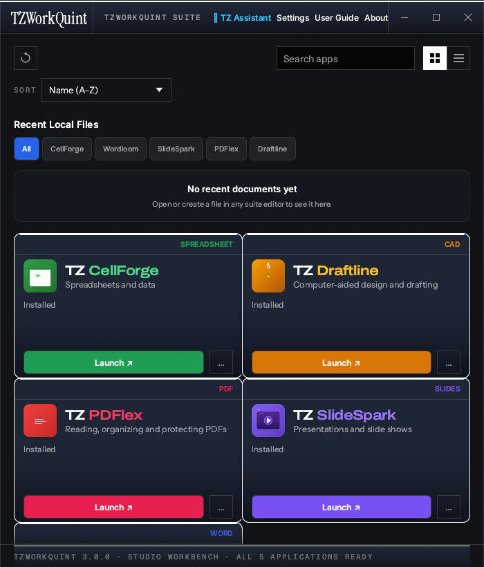
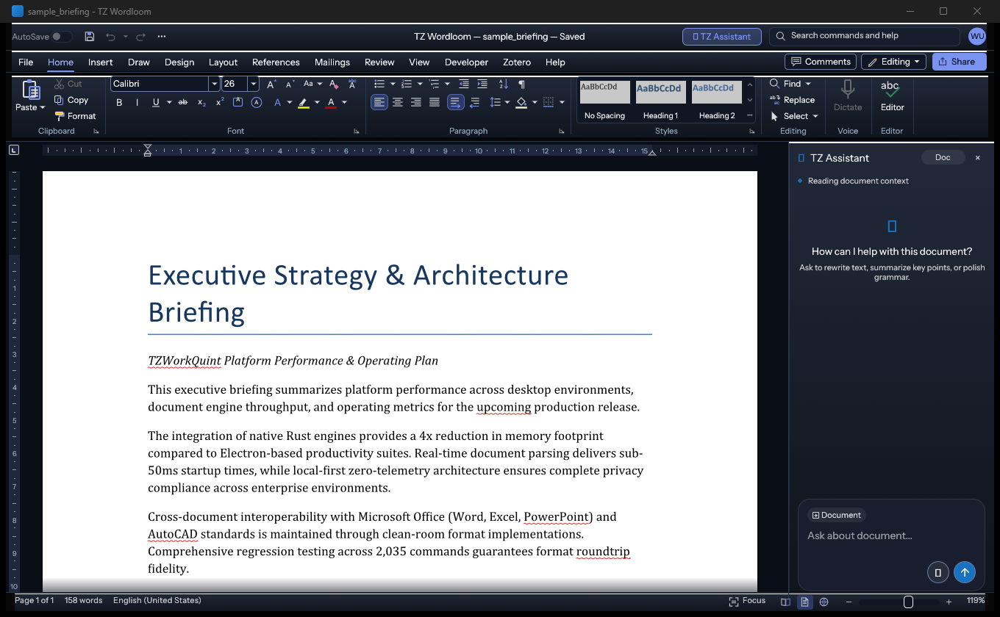
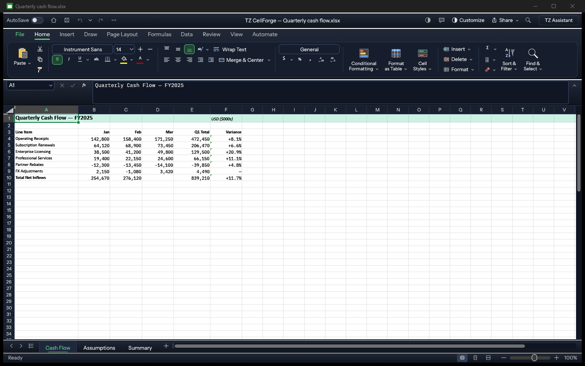
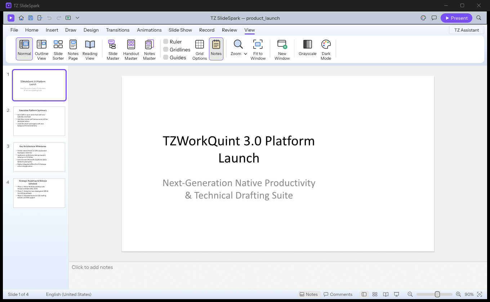
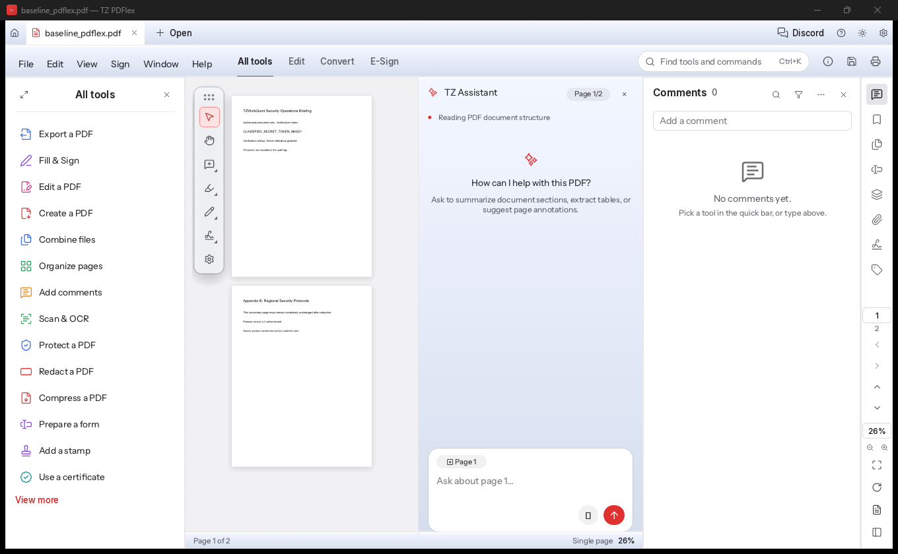
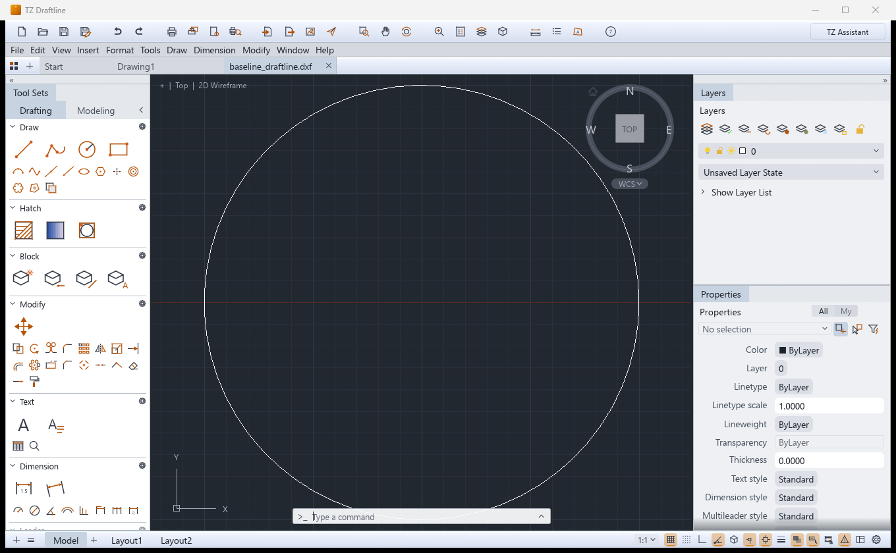

# Getting Started with TZWorkQuint

TZWorkQuint from TZLabs is a native desktop productivity and engineering suite. It bundles five high-performance document editors with a unified launcher and contextual AI assistance.

Every editor runs in its own independent Windows process with a dedicated taskbar button and native OS window.

---

## The Suite at a Glance

| Application | Brand Accent | File Formats | Primary Tasks |
| :--- | :---: | :--- | :--- |
| **TZWorkQuint (Hub)** | `#2563EB` Cobalt | Suite Launcher | Central project launcher, recent file history, suite settings |
| **TZ Wordloom** | `#1971C2` Blue | `.docx`, `.doc`, `.txt` | Document formatting, typographic styling, editing dock |
| **TZ CellForge** | `#10B981` Emerald | `.xlsx`, `.xls`, `.csv` | High-performance spreadsheets, financial models, formula analysis |
| **TZ SlideSpark** | `#7950F2` Violet | `.pptx`, `.ppt` | Slide design, deck presentations, presenter notes |
| **TZ PDFlex** | `#E03131` Crimson | `.pdf` | PDF viewing, document annotation, highlight markup |
| **TZ Draftline** | `#D97706` Amber | `.dxf`, `.dwg` | 2D CAD drafting, geometric constraints, technical coordinates |

---

## 1. Launching Applications

### From the Hub
Start `tz-workquint.exe` from your Start Menu or portable folder:

- Click **Launch** on any application card.
- The editor immediately spawns in an independent window. Closing the Hub does not close your open editors.

### Direct Execution
You can also run any editor executable directly from `bin/` or associate file extensions with them (`.docx` with `tz-wordloom.exe`, `.xlsx` with `tz-cellforge.exe`, etc.).

---

## 2. Editor Quickstarts

### Wordloom (Word Processor)

1. Start Wordloom and select **Blank Document**.
2. Type your prose, apply headings from the ribbon, and adjust paragraph margins using the ruler.
3. Save your file natively as standard Microsoft Word `.docx`.

### CellForge (Spreadsheets)

1. Start CellForge and enter numbers into column D.
2. Type `=SUM(D4:D9)` into the formula bar.
3. Save your workbook natively as Microsoft Excel `.xlsx`.

### SlideSpark (Presentations)

1. Start SlideSpark and choose a presentation layout.
2. Add slides, format slide bullets, and enter speaker notes in the lower pane.
3. Press **Present** for full-screen slide delivery.

### PDFlex (PDF Markup)

1. Open any PDF document in PDFlex.
2. Use the left toolbar to select text highlight, sticky notes, or freehand drawing tools.
3. Save your annotations directly back into the PDF.

### Draftline (2D CAD)

1. Open Draftline to load a 2D mechanical or architectural DXF drawing.
2. Use the command line interface or top tool panel to draw lines, circles, and dimension callouts.
3. Save your work cleanly as standard `.dxf`.

---

## 3. Offline User Guide
Every installation includes the comprehensive offline HTML manual located at:
`docs/user-guide/index.html` inside the installed or extracted suite folder.

