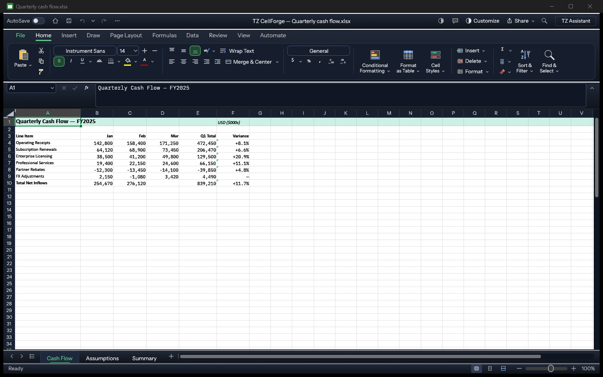

# TZ CellForge User Guide

**TZ CellForge** (`tz-cellforge.exe`, `#10B981`) is the native desktop spreadsheet engine in the TZWorkQuint suite. It delivers high-performance workbook recalculations, financial modeling, and AI formula synthesis.

---

## 1. Grid Engine & High-Performance Formulas

- **Instant Grid Rendering:** Virtualized viewport capable of smoothly navigating millions of cells at native 60fps.
- **Formula Bar:** Multi-line expandable formula bar with Name Box, syntax highlighting, and parenthetical matching.
- **Full Excel XLSX Compatibility:** Native read and write support for `.xlsx`, `.xls`, and `.csv` files.

---

## 2. Selection & Contextual Assistant

- **Range Selection:** Select any block of cells (e.g. `D4:D9`) to immediately see real-time statistics in the bottom status bar (Sum, Average, Count, Min, Max).
- **Formula Proposals:** Ask the assistant to build complex nested formulas (e.g., `SUMIFS`, `XLOOKUP`, `INDEX/MATCH`, statistical projections).
- **Proposal Cards:** Proposals appear in a distinct floating card with syntax-highlighted code and **Apply** / **Discard** action pills. Applying automatically inserts the formula into your target cell.

---

## 3. Template Catalog

Start fresh from pre-built financial models, quarterly cash flows, budget planners, and inventory trackers directly from the start screen template catalog.

---

## 4. Keyboard Shortcuts

- `F2`: Edit active cell
- `Ctrl + Shift + Enter`: Array formula entry
- `Ctrl + Arrow`: Jump to boundary of data region
- `Ctrl + Shift + A`: Toggle Assistant dock
- `Ctrl + S`: Save workbook

