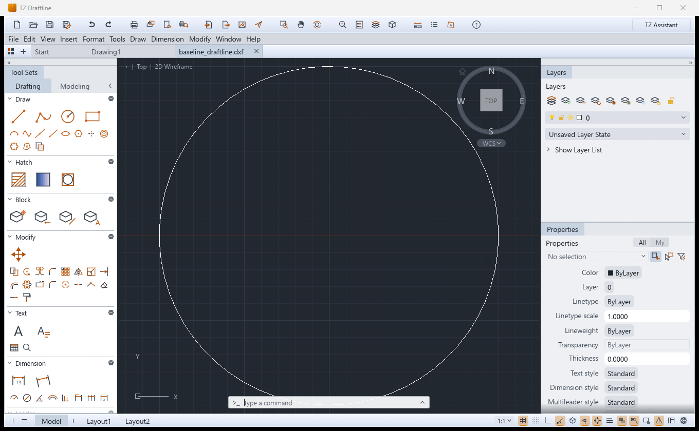

# TZ Draftline User Guide

**TZ Draftline** (`tz-draftline.exe`, `#D97706`) is the native desktop 2D CAD drafting and geometric modeling studio in the TZWorkQuint suite. It provides precise technical drawing, coordinate navigation, and geometric constraint tools.

---

## 1. 2D CAD Viewport & Precision Coordinate Input

- **Hardware-Accelerated Viewport:** Infinite 2D drawing canvas with smooth pan, zoom, and real-time coordinate readout.
- **Command Line Interface (CLI):** Enter classic CAD commands (`LINE`, `CIRCLE`, `ARC`, `DIM`, `OFFSET`, `TRIM`, `EXTEND`) with keyboard parameters.
- **DXF Compatibility:** Native read and write support for AutoCAD `.dxf` format drawings.

---

## 2. Properties Dock & Assistant Layout

- **Zero Collision Layout:** The assistant dock and properties panel maintain separate responsive bounds without control overlap, even at narrow 280px dock widths.
- **Geometry Proposals:** Ask the assistant to generate geometric paths or calculate bounding coordinates; review code in an edit card before applying to the drawing.

---

## 3. Keyboard Shortcuts & Commands

- `L` / `LINE`: Draw straight line segment
- `C` / `CIRCLE`: Draw circle by center and radius
- `Z` + `E`: Zoom extents
- `Ctrl + S`: Save DXF drawing
- `Escape`: Cancel current drawing command

