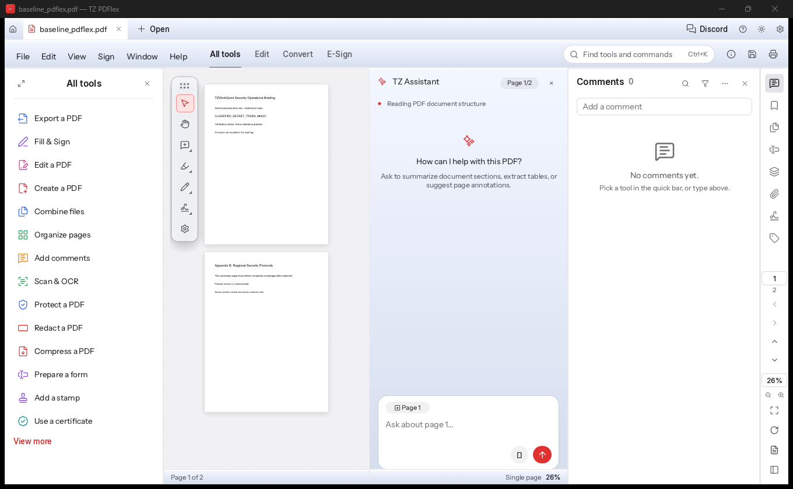
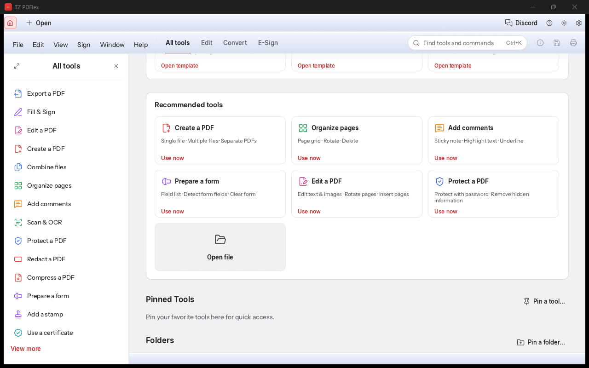

# TZ PDFlex User Guide

**TZ PDFlex** (`tz-pdflex.exe`, `#E03131`) is the native desktop PDF reader and markup studio in the TZWorkQuint suite. It provides fluid document rendering, annotations, and text highlight tools.

---

## 1. Document Viewing & Edge-to-Edge Chrome

- **Elimination of Black Strips:** PDFlex features edge-to-edge painted chrome across its top toolbar, mode bar, and bottom status bar:

- **High-Performance PDF Engine:** Fast vector rendering, smooth continuous scroll, multi-page layout, and zoom controls.

---

## 2. Annotation & Markup Tools

- **Highlight & Underline:** Mark key passages with customizable annotation colors.
- **Sticky Notes:** Place comments on specific page locations.
- **Direct Save:** Save annotated PDF files directly without rasterizing pages or corrupting vector graphics.

---

## 3. Keyboard Shortcuts

- `Ctrl + 0`: Fit page to window
- `Ctrl + 1`: Actual size (100%)
- `Ctrl + Plus / Minus`: Zoom in / out
- `Ctrl + F`: Search text within PDF
- `Ctrl + S`: Save annotations

