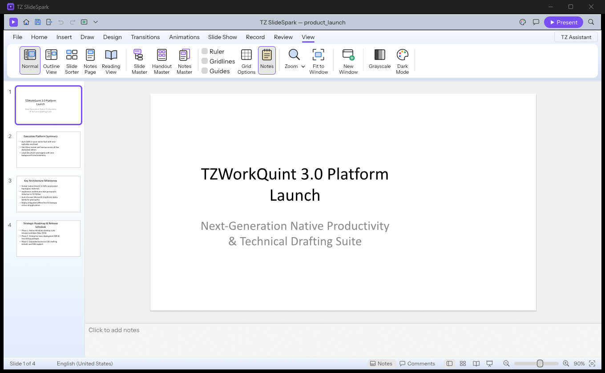
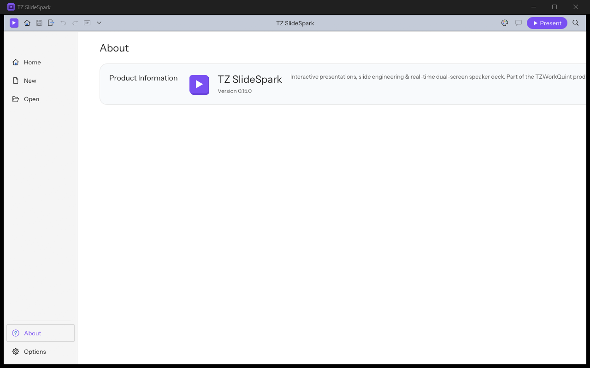

# TZ SlideSpark User Guide

**TZ SlideSpark** (`tz-slidespark.exe`, `#7950F2`) is the native desktop slide presentation studio in the TZWorkQuint suite. It enables smooth slide creation, deck choreography, and full-screen presentation delivery.

---

## 1. Presentation Canvas & Navigation

- **Slide Canvas:** High-fidelity slide editor with snap-to-grid alignment, text frames, shape drawing, and media placement.
- **Slide Thumbnail Navigator:** Left pane for reordering slides, duplicating cards, and managing presentation flow.
- **Speaker Notes:** Dedicated bottom pane for lecture notes and presenter cues.
- **Format Compatibility:** Native support for Microsoft PowerPoint `.pptx` and legacy `.ppt` files.

---

## 2. Full-Screen Presenter Mode

- Press **F5** or click **Present** to enter smooth, hardware-accelerated full-screen presentation mode.
- Use arrow keys or spacebar to advance transitions smoothly.

---

## 3. Backstage About & Settings

The `Home → About` backstage route presents comprehensive diagnostic information:

- Product version, platform architecture, GPU adapter diagnostic data, third-party software notices, and appearance preferences.

---

## 4. Keyboard Shortcuts

- `F5`: Start presentation from slide 1
- `Shift + F5`: Start presentation from current slide
- `Ctrl + M`: Insert new slide
- `Ctrl + D`: Duplicate selected slide
- `Escape`: Exit presentation mode

