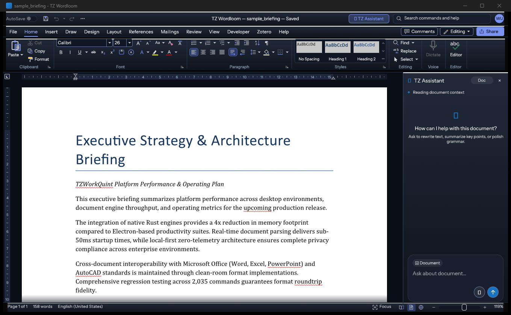

# TZ Wordloom User Guide

**TZ Wordloom** (`tz-wordloom.exe`, `#1971C2`) is the native desktop word processor in the TZWorkQuint suite. It is designed for authoring reports, articles, specifications, and books with high typographical fidelity.

---

## 1. Document Editing Workspace

- **Page View & Interactive Ruler:** Realistic page canvas with margins adjustable directly from the top horizontal ruler.
- **Ribbon Interface:** Clean, structured tabs for Font styling, Paragraph formatting, Headings, Insert elements, and Page Setup.
- **Format Compatibility:** Native support for saving and loading standard Microsoft Word `.docx` and legacy `.doc` files without layout distortion.

---

## 2. Typographic Polish

- **High-DPI Font Rendering:** Crisp subpixel text rasterization across custom Latin, CJK, and Unicode glyph sets.
- **Hierarchy & Styles:** Fast heading styles (`Heading 1`, `Heading 2`, `Heading 3`, `Body`, `Quote`, `Code block`).

---

## 3. Contextual Assistant & Passage Rewriting

- **Doc Scope Chip:** When the assistant is open, it highlights your selected paragraph or document section.
- **Passage Proposals:** Request grammar refinements, tone adjustments, or executive summaries. Proposals are presented in dedicated review cards with **Apply** and **Discard** pills.
- **Separate Controls:** Circular 30×30 hit targets for Voice/Mic and Send buttons ensure accurate touch and mouse input.

---

## 4. Keyboard Shortcuts

- `Ctrl + N`: New blank document
- `Ctrl + O`: Open file picker
- `Ctrl + S`: Save document
- `Ctrl + B`: Bold text
- `Ctrl + I`: Italicize text
- `Ctrl + Shift + A`: Toggle TZ Assistant dock

