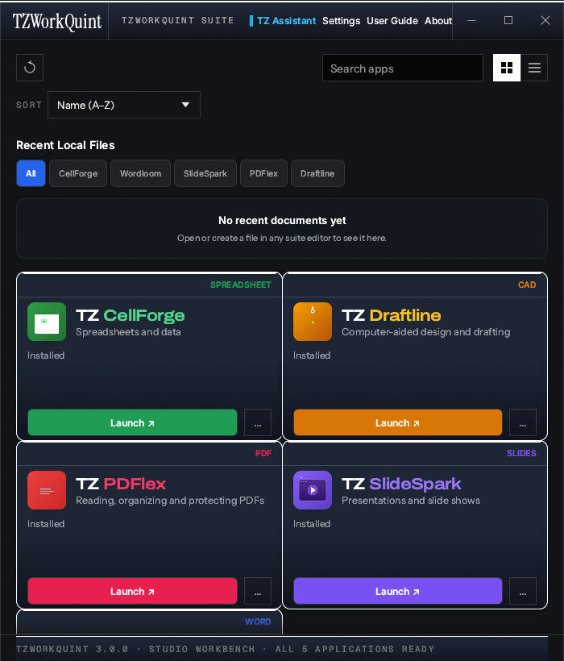

# TZWorkQuint Suite Launcher Guide

The **TZWorkQuint Hub** (`tz-workquint.exe`, `#2563EB`) is the central desktop entry point for the suite. It allows you to quickly start editors, access recent projects, configure suite-wide preferences, and consult offline documentation.

---

## 1. Window Architecture & Process Detachment

- **Independent Windows:** Unlike monolithic office suites that host documents in tabs inside a single shell, each TZWorkQuint editor runs as an independent OS process with its own native window, event loop, and GPU rendering context.
- **Detached Lifecycle:** Launching an editor from the Hub starts a completely detached process. You can freely close or minimize the Hub to your system tray; all your document editors continue running uninterrupted.
- **Responsive Sizing:** The Hub opens at a comfortable 700×820 size and responsively adapts down to a single-column 500×820 layout on narrow displays without horizontal clipping or card truncation.

---

## 2. Recent Files Management

The Hub provides instant access to your recently opened documents across all five applications:
- **Zero Pollution Guarantee:** Recent document state is stored in your user profile and indexed cleanly by last modification time.
- **Direct Launch:** Clicking a recent document launches its appropriate editor directly and opens the file in a single click.

---

## 3. Suite Assistant

The Hub includes a suite-wide prompt composer (accessible via the sparkle icon in the header) for asking questions across tools or discovering keyboard shortcuts.

---

## 4. About & Legal Notices

Click **About TZWorkQuint** to view your verified release version, licensing information, third-party software attributions, and a direct link to the [TZLabs Official Portal](https://tzlabs.in).

