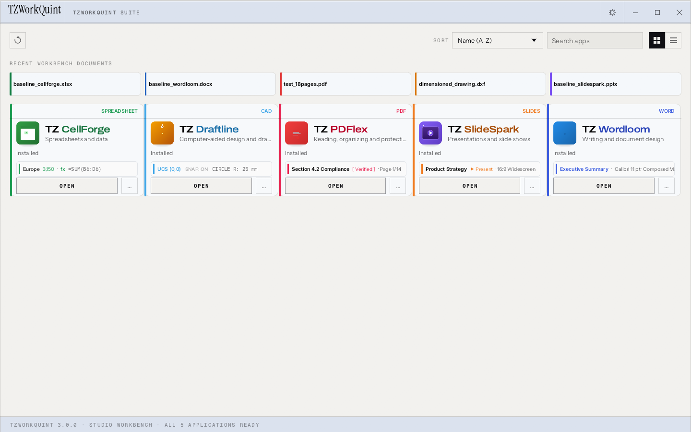
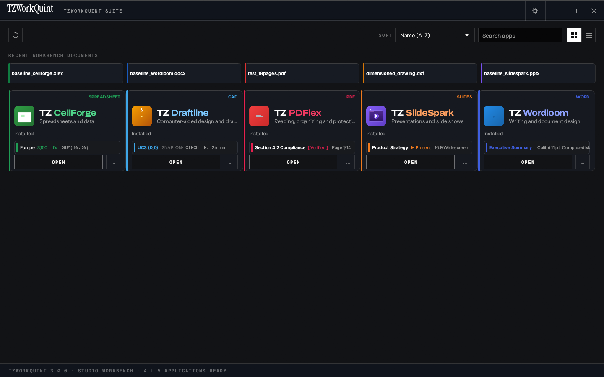

# 01. TZWorkQuint Hub Guide

The **TZWorkQuint Hub** (`tz-workquint.exe`) is the unified central launcher, workspace manager, and discovery portal for the TZWorkQuint suite. It provides one-click launching for all five native editors, recent document indexing, application filtering, appearance customization, and offline documentation access.

*Figure 1.1: TZWorkQuint Hub in Pearl Glass mode showing application cards, search, and view controls.*

---

## The First Five Minutes

1. **Launch the Hub:**  
   Open the suite by double-clicking the **TZWorkQuint** desktop shortcut or launching `bin\tz-workquint.exe`. The Hub appears immediately with a clean, responsive layout.

2. **Select an Application:**  
   Move your mouse over any application card. You will observe a gentle specular lighting highlight and soft border elevation.
   - Click **TZ CellForge** to open the spreadsheet editor.
   - Click **TZ Wordloom** to open the document editor.
   - Click **TZ SlideSpark** to open the slide presentation creator.
   - Click **TZ PDFlex** to inspect or redact PDF documents.
   - Click **TZ Draftline** to start 2D technical CAD drafting.

3. **Filter and Search:**  
   If you have many documents or wish to narrow your focus:
   - Click **Productivity** in the filter bar to display Wordloom, CellForge, and SlideSpark.
   - Click **Engineering** to display Draftline and PDFlex.
   - Press <kbd>Ctrl</kbd>+<kbd>F</kbd> and type a query (e.g. `sheet` or `pdf`) to filter instantaneously.

4. **Toggle View & Appearance:**  
   - Press the **List View** button (<kbd>Ctrl</kbd>+<kbd>2</kbd>) in the top toolbar to switch to a dense, detail-oriented layout.
   - Click the **Gear icon** in the top right corner to open Hub Preferences and switch between **Pearl Glass** (light frosting), **Smoked Glass** (deep dark backing), or **Solid Glass Off**.

*Figure 1.2: TZWorkQuint Hub in Smoked Glass dark mode.*

---

## Function & Option Reference

The table below catalogs every user-facing command, toolbar action, and setting in the TZWorkQuint Hub:

| Command ID | Visible Label | Route / Location | Shortcut | Prerequisites | Expected Outcome |
|---|---|---|---|---|---|
| `hub.launch_cellforge` | **TZ CellForge** | Home Grid › CellForge Card | *None* | Installed | Launches `bin\tz-cellforge.exe` in a fresh window. |
| `hub.launch_wordloom` | **TZ Wordloom** | Home Grid › Wordloom Card | *None* | Installed | Launches `bin\tz-wordloom.exe` in a fresh window. |
| `hub.launch_pdflex` | **TZ PDFlex** | Home Grid › PDFlex Card | *None* | Installed | Launches `bin\tz-pdflex.exe` in a fresh window. |
| `hub.launch_draftline` | **TZ Draftline** | Home Grid › Draftline Card | *None* | Installed | Launches `bin\tz-draftline.exe` in a fresh window. |
| `hub.launch_slidespark` | **TZ SlideSpark** | Home Grid › SlideSpark Card | *None* | Installed | Launches `bin\tz-slidespark.exe` in a fresh window. |
| `hub.search` | **Search Apps** | Header › Search Input Field | <kbd>Ctrl</kbd>+<kbd>F</kbd> | Hub Open | Filters cards in real time by name, category, or role. |
| `hub.view_grid` | **Grid View** | Top Toolbar › Grid Icon | <kbd>Ctrl</kbd>+<kbd>1</kbd> | Hub Open | Arranges applications in a multi-column card grid. |
| `hub.view_list` | **List View** | Top Toolbar › List Icon | <kbd>Ctrl</kbd>+<kbd>2</kbd> | Hub Open | Arranges applications in a single-column detailed list. |
| `hub.filter_all` | **All** | Category Filter Bar › All | *None* | Hub Open | Displays all five editors and suite utilities. |
| `hub.filter_productivity` | **Productivity** | Category Filter Bar › Productivity | *None* | Hub Open | Filters list to Wordloom, CellForge, and SlideSpark. |
| `hub.filter_engineering` | **Engineering** | Category Filter Bar › Engineering | *None* | Hub Open | Filters list to Draftline and PDFlex. |
| `hub.sort` | **Sort By** | Header › Sort Dropdown | *None* | Hub Open | Orders items by *Suite Order*, *Name (A–Z)*, or *Last Used*. |
| `hub.settings` | **Preferences** | Header › Gear Icon | <kbd>Ctrl</kbd>+<kbd>,</kbd> | Hub Open | Opens modal settings for themes, tray behavior, and paths. |
| `hub.theme_pearl` | **Pearl Glass** | Preferences › Appearance › Pearl | *None* | Preferences Open | Enables light mode with directional liquid glass frosting. |
| `hub.theme_smoked` | **Smoked Glass** | Preferences › Appearance › Smoked | *None* | Preferences Open | Enables dark mode with liquid material depth on dark backing. |
| `hub.theme_glass_off` | **Solid (Glass Off)** | Preferences › Appearance › Solid | *None* | Preferences Open | Disables transparency for low-contrast / low-power displays. |
| `hub.help` | **User Guide** | Footer › User Guide Link | <kbd>F1</kbd> | Hub Open | Opens offline user manual in the default system browser. |
| `hub.about` | **About** | Header › Info Icon / Preferences | *None* | Hub Open | Displays version 3.0.0, commit hash, license, and credits. |

---

## Hub Preferences & Workspace Options

Clicking the **Gear** icon opens the Hub Preferences modal dialog:

*Figure 1.3: Hub Preferences dialog managing appearance, tray behavior, and launch options.*

1. **Appearance Theme:**  
   - **System:** Synchronizes automatically with Windows light or dark mode.
   - **Pearl (Light Glass):** High-contrast daylight interface with calibrated top specular highlight rim (`255, 255, 255, 180`) and bottom shaded edge.
   - **Smoked (Dark Glass):** Night-mode interface minimizing eye fatigue with deep translucent slate panels.
   - **Solid (Glass Off):** Replaces all glass translucency with opaque surfaces.

2. **Window & Tray Behavior:**  
   - **Close to System Tray:** When enabled, closing the Hub window keeps the application resident in the Windows Notification Area (System Tray) for instant recall without startup latency.
   - **Show on Current Virtual Desktop:** Restores the Hub on whichever virtual desktop is active when invoked from the tray.

3. **Persistence:**  
   All Hub configuration settings are saved immediately to `%APPDATA%\tz.workquint.launcher\data\app.ron` and persist permanently across reboots and upgrades.

