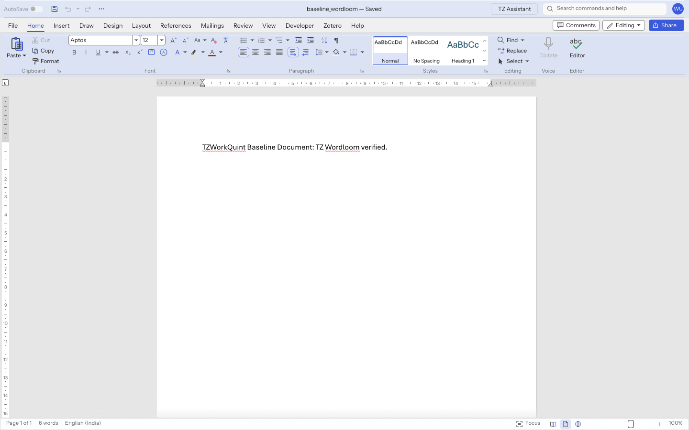
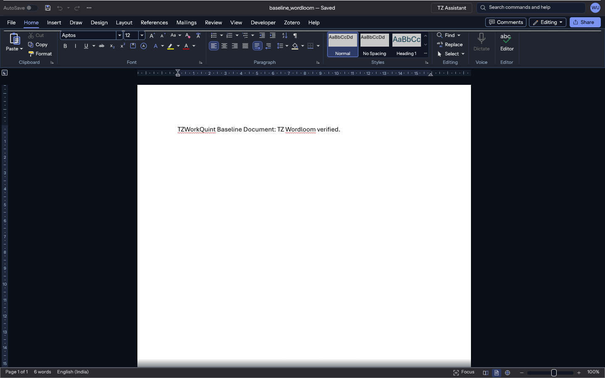

# 02. TZ Wordloom Guide

**TZ Wordloom** (`tz-wordloom.exe`) is the dedicated professional document creation, typographical layout, and collaborative review environment in the TZWorkQuint suite. It reads and writes standard Microsoft Word OpenXML (`.docx`) files with high typographical fidelity, tracked revisions, threaded commentary, and complete local privacy.

*Figure 2.1: TZ Wordloom in Pearl Glass mode displaying ribbon tabs, typographical ruler, and multi-page canvas.*

---

## The First Five Minutes

Follow this quick walkthrough using a disposable sample file to familiarize yourself with Wordloom:

1. **Create a Document:**  
   Launch Wordloom from the Hub or run `bin\tz-wordloom.exe`. Press <kbd>Ctrl</kbd>+<kbd>N</kbd> for a clean document, or launch with `--sample` to load the built-in typographical sample.

2. **Compose and Format Text:**  
   - Type a title (e.g. `Executive Project Briefing`) and press <kbd>Enter</kbd>.
   - Select the title and choose **Title** from the **Styles Gallery** on the Home tab.
   - Type body text. Highlight words to apply **Bold** (<kbd>Ctrl</kbd>+<kbd>B</kbd>), **Italic** (<kbd>Ctrl</kbd>+<kbd>I</kbd>), or **Highlight**.

3. **Insert Tables and Elements:**  
   - Switch to the **Insert** tab on the ribbon.
   - Click **Table ▾** and drag across the grid to insert a 3×3 table. Tab through cells to populate data.
   - Click **Page Break** (<kbd>Ctrl</kbd>+<kbd>Enter</kbd>) to cleanly start a new page.

4. **Track Changes & Add Comments:**  
   - Switch to the **Review** tab and click **Track Changes** (<kbd>Ctrl</kbd>+<kbd>Shift</kbd>+<kbd>E</kbd>). Subsequent edits appear in inline revision colors with marginal markup.
   - Select a phrase and click **New Comment** (<kbd>Ctrl</kbd>+<kbd>Alt</kbd>+<kbd>M</kbd>) to pin a reviewer note in the margin.

5. **Save and Export:**  
   - Press <kbd>Ctrl</kbd>+<kbd>S</kbd> to save as standard `.docx`.
   - Click **File › Export › PDF** to produce a publication-grade vector PDF.

*Figure 2.2: TZ Wordloom in Smoked Glass dark mode.*

---

## Ribbon Tabs & Function Reference

### 1. Home Tab: Typography & Styles

The Home tab houses everyday text editing, paragraph formatting, and the hierarchical style catalog:

| Command ID | Visible Label | Route / Group | Shortcut | Prerequisites | Expected Outcome |
|---|---|---|---|---|---|
| `edit.undo` | **Undo** | Quick Access / Home | <kbd>Ctrl</kbd>+<kbd>Z</kbd> | Can Undo | Reverts previous editing action. |
| `edit.redo` | **Redo** | Quick Access / Home | <kbd>Ctrl</kbd>+<kbd>Y</kbd> | Can Redo | Reapplies undone editing action. |
| `edit.cut` | **Cut** | Clipboard | <kbd>Ctrl</kbd>+<kbd>X</kbd> | Text Selected | Copies selection to clipboard and removes it. |
| `edit.copy` | **Copy** | Clipboard | <kbd>Ctrl</kbd>+<kbd>C</kbd> | Text Selected | Copies selection to system clipboard. |
| `edit.paste` | **Paste** | Clipboard | <kbd>Ctrl</kbd>+<kbd>V</kbd> | Text in Clip | Inserts clipboard contents at cursor. |
| `font.family` | **Font Family** | Font Group | *None* | Text Selected | Applies selected typeface (e.g. Aptos, Inter, Calibri). |
| `font.size` | **Font Size** | Font Group | <kbd>Ctrl</kbd>+<kbd>[</kbd> / <kbd>]</kbd> | Text Selected | Sets typographical point size (8pt–72pt). |
| `format.bold` | **Bold** | Font Group | <kbd>Ctrl</kbd>+<kbd>B</kbd> | Text Selected | Toggles bold weight styling. |
| `format.italic` | **Italic** | Font Group | <kbd>Ctrl</kbd>+<kbd>I</kbd> | Text Selected | Toggles italic slant styling. |
| `format.underline` | **Underline** | Font Group | <kbd>Ctrl</kbd>+<kbd>U</kbd> | Text Selected | Toggles single baseline underline. |
| `format.strikethrough` | **Strikethrough**| Font Group | *None* | Text Selected | Toggles horizontal middle strikethrough. |
| `format.color` | **Font Color** | Font Group | *None* | Text Selected | Opens palette to apply character foreground color. |
| `format.highlight` | **Text Highlight**| Font Group | *None* | Text Selected | Applies translucent marker background color. |
| `para.align_left` | **Align Left** | Paragraph | <kbd>Ctrl</kbd>+<kbd>L</kbd> | In Paragraph | Aligns paragraph flush with left margin. |
| `para.align_center` | **Center** | Paragraph | <kbd>Ctrl</kbd>+<kbd>E</kbd> | In Paragraph | Centers lines between page margins. |
| `para.align_right` | **Align Right** | Paragraph | <kbd>Ctrl</kbd>+<kbd>R</kbd> | In Paragraph | Aligns paragraph flush with right margin. |
| `para.justify` | **Justify** | Paragraph | <kbd>Ctrl</kbd>+<kbd>J</kbd> | In Paragraph | Expands inter-word spacing to align both margins. |
| `para.bullet_list` | **Bullets** | Paragraph | <kbd>Ctrl</kbd>+<kbd>Shift</kbd>+<kbd>L</kbd> | In Paragraph | Toggles unordered bulleted list formatting. |
| `para.number_list` | **Numbering** | Paragraph | *None* | In Paragraph | Toggles auto-incrementing numbered list. |
| `styles.gallery` | **Styles** | Styles Gallery | *None* | In Paragraph | Applies Normal, Heading 1–4, Title, Subtitle, or Quote. |

### 2. Insert Tab: Tables, Pages & Commentary

| Command ID | Visible Label | Route / Group | Shortcut | Prerequisites | Expected Outcome |
|---|---|---|---|---|---|
| `text.pageBreak` | **Page Break** | Pages | <kbd>Ctrl</kbd>+<kbd>Enter</kbd> | Document Open | Inserts hard page break; pushes trailing text to next page. |
| `table.insert` | **Table** | Tables | *None* | In Body Text | Inserts matrix table with specified rows and columns. |
| `table.insert_row_above` | **Insert Above** | Table Tools › Layout | *None* | Inside Table | Adds new row above the selected cell. |
| `table.insert_col_left` | **Insert Left** | Table Tools › Layout | *None* | Inside Table | Adds new column left of the selected cell. |
| `table.delete_row` | **Delete Row** | Table Tools › Layout | *None* | Inside Table | Deletes current table row. |
| `table.delete_col` | **Delete Column** | Table Tools › Layout | *None* | Inside Table | Deletes current table column. |
| `comment.add` | **New Comment** | Comments | <kbd>Ctrl</kbd>+<kbd>Alt</kbd>+<kbd>M</kbd>| Text Selected | Creates threaded comment balloon anchored to selection. |
| `link.insert` | **Hyperlink** | Links | <kbd>Ctrl</kbd>+<kbd>K</kbd> | Text Selected | Binds external URL or intra-document bookmark. |

### 3. Layout Tab: Geometry & Margins

| Command ID | Visible Label | Route / Group | Shortcut | Prerequisites | Expected Outcome |
|---|---|---|---|---|---|
| `layout.margins` | **Margins** | Page Setup | *None* | Document Open | Configures Normal (1"), Narrow (0.5"), Moderate, or Custom. |
| `layout.orientation`| **Orientation** | Page Setup | *None* | Document Open | Switches document between Portrait and Landscape. |
| `layout.size` | **Size** | Page Setup | *None* | Document Open | Sets paper geometry to Letter, A4, Legal, or Executive. |
| `layout.columns` | **Columns** | Page Setup | *None* | Document Open | Splits body layout into 1, 2, or 3 balanced newspaper columns.|

### 4. Review Tab: Tracking & Quality Assurance

| Command ID | Visible Label | Route / Group | Shortcut | Prerequisites | Expected Outcome |
|---|---|---|---|---|---|
| `review.track_changes`| **Track Changes** | Tracking | <kbd>Ctrl</kbd>+<kbd>Shift</kbd>+<kbd>E</kbd>| Document Open | Records insertions, deletions, and formatting changes. |
| `review.accept` | **Accept Change** | Changes | *None* | Revision Active| Accepts current change and advances to the next. |
| `review.reject` | **Reject Change** | Changes | *None* | Revision Active| Discards current change and restores original text. |
| `review.next` | **Next** | Changes | *None* | Revisions Exist| Moves selection to the next tracked change. |
| `review.prev` | **Previous** | Changes | *None* | Revisions Exist| Moves selection to the previous tracked change. |
| `tools.word_count` | **Word Count** | Proofing | <kbd>Ctrl</kbd>+<kbd>Shift</kbd>+<kbd>G</kbd>| Document Open | Displays dialog with pages, words, chars, paras, lines. |

---

## Review & Collaboration Workflows

### Worked Example: Tracked Editorial Revisions

1. Open `baseline_wordloom.docx`.
2. Navigate to **Review › Track Changes** and ensure the button highlight is active.
3. Replace a word in the second paragraph (e.g. change `initial` to `streamlined`). Notice `initial` displays in red strikethrough and `streamlined` displays in underlined green.
4. Add a comment: select the modified sentence, click **Review › New Comment**, and enter `Review with legal team before final release`.
5. Save the document with <kbd>Ctrl</kbd>+<kbd>S</kbd>.
6. Open the file in Microsoft Word 2024: Word recognizes all tracked insertions, deletions, and marginal comments seamlessly with zero compatibility prompts.

