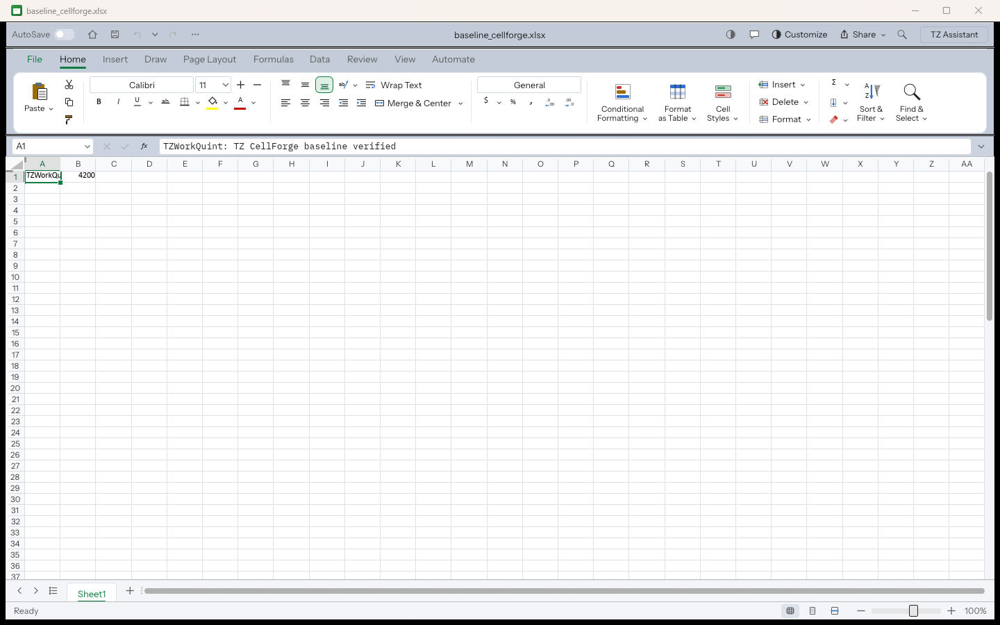
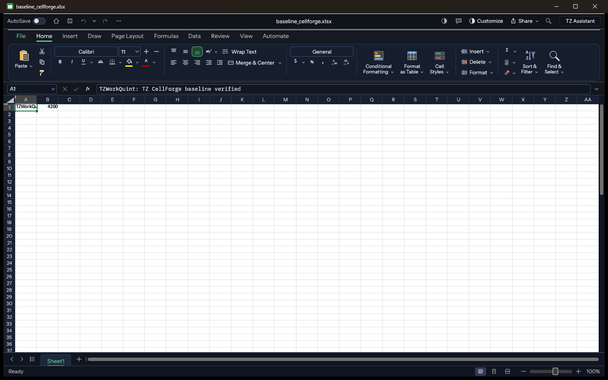

# 03. TZ CellForge Guide

**TZ CellForge** (`tz-cellforge.exe`) is the spreadsheet analysis, mathematical modeling, and PivotTable reporting application in the TZWorkQuint suite. It reads, calculates, and exports Microsoft Excel OpenXML (`.xlsx`) workbooks with formula fidelity, dynamic range computation, sorting, filtering, and local data sovereignty.

*Figure 3.1: TZ CellForge in Pearl Glass mode showing formula bar, grid cells, and bottom sheet tabs.*

---

## The First Five Minutes

1. **Create or Open a Workbook:**  
   Launch CellForge from the Hub or run `bin\tz-cellforge.exe`. Press <kbd>Ctrl</kbd>+<kbd>N</kbd> for a clean workbook, or launch with `--sample` to explore the financial budget model.

2. **Enter Data and Formulas:**  
   - Click cell `A1` and type `Q1 Revenue`.
   - In cell `A2`, type `1000`. In cell `A3`, type `1500`.
   - In cell `A4`, click the **Formula Bar** and type `=SUM(A2:A3)`, then press <kbd>Enter</kbd>. The cell calculates `2500` immediately.

3. **Format Numbers & Cells:**  
   - Select `A2:A4`. On the **Home** tab, click the **Currency ($)** button to format values as `$1,000.00`, `$1,500.00`, and `$2,500.00`.
   - Apply a soft fill color to the header in `A1` using the **Fill Color** bucket.

4. **Sort and Filter:**  
   - Select your data range and click **Sort & Filter ▾ › Filter** (<kbd>Ctrl</kbd>+<kbd>Shift</kbd>+<kbd>L</kbd>). Dropdown filter arrows appear on each column header.
   - Click a header arrow to sort ascending, descending, or filter specific values.

5. **Create a PivotTable:**  
   - Switch to the **Insert** tab on the ribbon and click **PivotTable**.
   - Specify your source range (e.g. `Sheet1!A1:B10`) and target sheet. CellForge builds the interactive pivot summary.

6. **Save as XLSX:**  
   - Press <kbd>Ctrl</kbd>+<kbd>S</kbd> to save. The file roundtrips with 100% fidelity in Microsoft Excel 2024.

*Figure 3.2: TZ CellForge in Smoked Glass dark mode.*

---

## Ribbon Tabs & Function Reference

### 1. Home Tab: Grid Editing & Formatting

| Command ID | Visible Label | Route / Group | Shortcut | Prerequisites | Expected Outcome |
|---|---|---|---|---|---|
| `edit.undo` | **Undo** | Quick Access / Home | <kbd>Ctrl</kbd>+<kbd>Z</kbd> | Can Undo | Reverts previous cell or sheet edit. |
| `edit.redo` | **Redo** | Quick Access / Home | <kbd>Ctrl</kbd>+<kbd>Y</kbd> | Can Redo | Reapplies undone cell action. |
| `clipboard.paste` | **Paste** | Clipboard | <kbd>Ctrl</kbd>+<kbd>V</kbd> | Data in Clip | Pastes values, formulas, or formatting. |
| `clipboard.copy` | **Copy** | Clipboard | <kbd>Ctrl</kbd>+<kbd>C</kbd> | Selection | Copies range data to clipboard. |
| `clipboard.cut` | **Cut** | Clipboard | <kbd>Ctrl</kbd>+<kbd>X</kbd> | Selection | Copies and clears source cells. |
| `format.bold` | **Bold** | Font Group | <kbd>Ctrl</kbd>+<kbd>B</kbd> | Cells Selected | Toggles bold weight on cell contents. |
| `format.italic` | **Italic** | Font Group | <kbd>Ctrl</kbd>+<kbd>I</kbd> | Cells Selected | Toggles italic slant on cell contents. |
| `format.fill_color` | **Fill Color** | Font Group | *None* | Cells Selected | Sets background fill tint of selected range. |
| `format.borders` | **Borders ▾** | Font Group | *None* | Cells Selected | Sets Bottom, Top, Left, Right, or All Borders. |
| `align.left` | **Align Left** | Alignment | <kbd>Ctrl</kbd>+<kbd>L</kbd> | Cells Selected | Aligns cell content flush left. |
| `align.center` | **Center** | Alignment | <kbd>Ctrl</kbd>+<kbd>E</kbd> | Cells Selected | Horizontally centers cell content. |
| `align.right` | **Align Right** | Alignment | <kbd>Ctrl</kbd>+<kbd>R</kbd> | Cells Selected | Aligns numbers/text flush right. |
| `align.merge` | **Merge & Center**| Alignment | *None* | Cells Selected | Combines multiple cells into one spanning cell.|
| `number.currency` | **Currency ($)** | Number Group | *None* | Cells Selected | Formats numbers with `$#,##0.00` mask. |
| `number.percent` | **Percent (%)** | Number Group | *None* | Cells Selected | Multiplies value by 100 and appends `%`. |
| `number.comma` | **Comma (,)** | Number Group | *None* | Cells Selected | Adds thousands separators without currency symbol.|
| `filter.toggle` | **Filter** | Editing | <kbd>Ctrl</kbd>+<kbd>Shift</kbd>+<kbd>L</kbd>| Range Selected | Toggles autofilter dropdown headers. |
| `sort.ascending` | **Sort A to Z** | Editing | *None* | Column Active | Orders selected rows ascending. |
| `sort.descending` | **Sort Z to A** | Editing | *None* | Column Active | Orders selected rows descending. |

### 2. Insert Tab: Tables, Pivots & Visualizations

| Command ID | Visible Label | Route / Group | Shortcut | Prerequisites | Expected Outcome |
|---|---|---|---|---|---|
| `insert.pivotTable` | **PivotTable** | Tables | *None* | Range Active | Opens dialog to construct dynamic summary table. |
| `table.create` | **Table** | Tables | <kbd>Ctrl</kbd>+<kbd>T</kbd> | Range Active | Converts range into banded Excel table. |
| `chart.insert_column`| **Column Chart** | Charts | *None* | Range Active | Inserts clustered vertical bar chart. |
| `chart.insert_line` | **Line Chart** | Charts | *None* | Range Active | Inserts trendline plot over series data. |
| `chart.insert_pie` | **Pie Chart** | Charts | *None* | Range Active | Inserts categorical percentage breakdown chart. |

### 3. Data Tab: PivotTable Operations & Validation

| Command ID | Visible Label | Route / Group | Shortcut | Prerequisites | Expected Outcome |
|---|---|---|---|---|---|
| `pivot.refresh` | **Refresh** | PivotTable Tools | <kbd>Alt</kbd>+<kbd>F5</kbd>| Inside Pivot | Re-evaluates pivot aggregations against source. |
| `pivot.changeSource`| **Change Source**| PivotTable Tools | *None* | Inside Pivot | Updates cell range coordinates for pivot table. |
| `calc.calculate_now`| **Calculate Now** | Calculation | <kbd>F9</kbd> | Workbook Open | Forces full calculation pass across all sheets. |
| `data.validation` | **Data Validation**| Data Tools | *None* | Cells Selected | Restricts cell input to lists, dates, or ranges. |

---

## PivotTable Worked Example

1. Open `test-docs/baseline_cellforge.xlsx`.
2. Select data range `A1:D25` containing Region, Product, Units, and Revenue.
3. Click **Insert › PivotTable**. Choose `New Sheet` as destination.
4. In the PivotTable configuration pane:
   - Drag `Region` to the **Rows** area.
   - Drag `Product` to the **Columns** area.
   - Drag `Revenue` to the **Values** area (summarized by `Sum`).
5. Notice the matrix summarizes regional revenue by product cleanly.
6. Edit a revenue number on the source sheet and press <kbd>Alt</kbd>+<kbd>F5</kbd> on the pivot sheet: the summary numbers recalculate instantly.
7. Save the workbook (<kbd>Ctrl</kbd>+<kbd>S</kbd>) and open in **Microsoft Excel 2024**: Excel recognizes the native pivot cache, fields, and values without corruption warnings.

