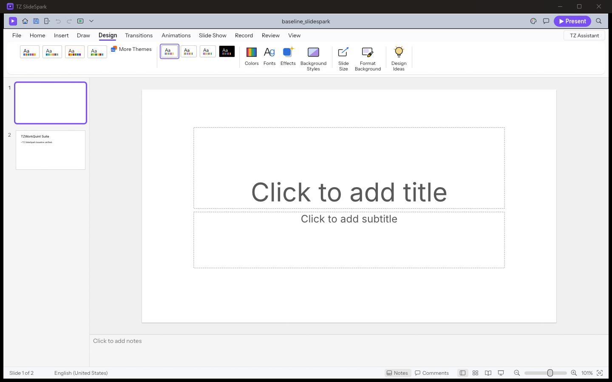
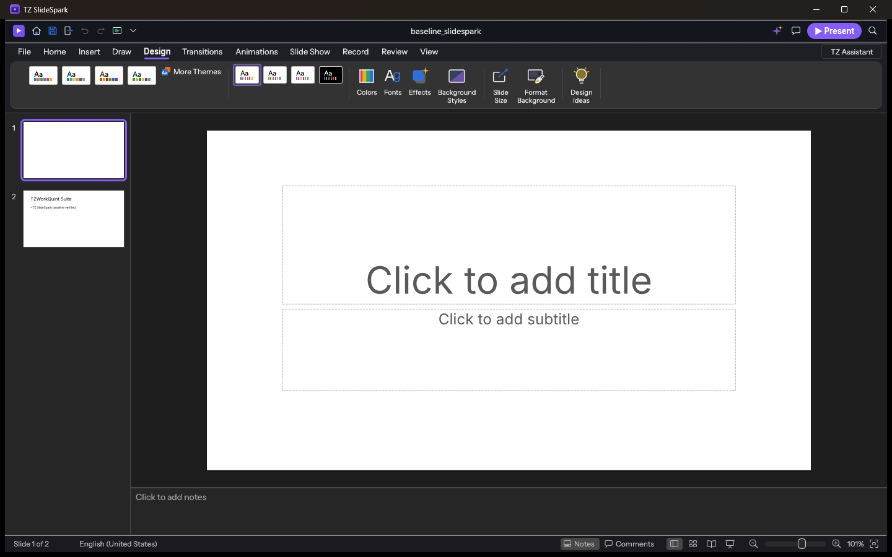

# 04. TZ SlideSpark Guide

**TZ SlideSpark** (`tz-slidespark.exe`) is the presentation graphics, pitch deck, and lecture delivery tool in the TZWorkQuint suite. It authors standard Microsoft PowerPoint OpenXML (`.pptx`) decks with typographical precision, curated themes, transition effects, speaker notes, and an offline Presenter View.

*Figure 4.1: TZ SlideSpark in Pearl Glass mode showing slide thumbnails, canvas, and Design ribbon.*

---

## The First Five Minutes

1. **Pick a Starter Deck:**  
   Launch SlideSpark from the Hub or run `bin\tz-slidespark.exe`. In the initial gallery, choose from six built-in starter templates:
   - **Briefing:** Weekly check-in deck (Theme: Harbor).
   - **Lesson:** Explanatory teaching deck (Theme: Meadow).
   - **Pitch:** 10-minute promise & investor deck (Theme: Ember).
   - **Field Notes:** Observational outing report (Theme: Coral Reef).
   - **Quarterly:** 30-minute operational report (Theme: Paper).
   - **Evening Talk:** Public keynote deck (Theme: Nocturne).

2. **Edit Slides and Typography:**  
   - Click any text placeholder to type headline or body bullets.
   - Use the **Home** tab to format fonts, sizes, colors, and line spacing.
   - Click **New Slide ▾** (<kbd>Ctrl</kbd>+<kbd>M</kbd>) to insert a Title, Two Content, or Comparison slide layout.

3. **Explore Themes & Variants:**  
   - Switch to the **Design** tab on the ribbon.
   - Choose one of the 4 visible theme swatches, or click **Themes ▾** to display the complete theme catalog.
   - Pick a color variant from the adjacent 4 variant tiles to instantly recolor the entire deck.

4. **Add Speaker Notes:**  
   - Click the **Notes** button on the bottom status bar to open the speaker notes pane beneath the slide canvas.
   - Enter private talking points visible only during Presenter View.

5. **Run the Slide Show:**  
   - Press <kbd>F5</kbd> to launch full-screen presentation from slide 1.
   - Press <kbd>Shift</kbd>+<kbd>F5</kbd> to start from the current slide.
   - Use arrow keys or spacebar to advance slides; press <kbd>Esc</kbd> to exit.

6. **Save as PPTX:**  
   - Press <kbd>Ctrl</kbd>+<kbd>S</kbd> to save. The file opens natively in **Microsoft PowerPoint 2024** without repair alerts.

*Figure 4.2: TZ SlideSpark in Smoked Glass dark mode.*

---

## Ribbon Tabs & Function Reference

### 1. Home Tab: Slides, Text & Layouts

| Command ID | Visible Label | Route / Group | Shortcut | Prerequisites | Expected Outcome |
|---|---|---|---|---|---|
| `slide.new` | **New Slide** | Slides | <kbd>Ctrl</kbd>+<kbd>M</kbd> | Deck Open | Adds new slide following current layout. |
| `slide.layout` | **Layout ▾** | Slides | *None* | Slide Active | Changes active slide's layout template. |
| `slide.duplicate` | **Duplicate Slide**| Slides | <kbd>Ctrl</kbd>+<kbd>D</kbd> | Slide Active | Clones current slide with all shapes. |
| `slide.delete` | **Delete Slide** | Slides | <kbd>Delete</kbd> | Slide Active | Removes active slide from deck. |
| `font.bold` | **Bold** | Font Group | <kbd>Ctrl</kbd>+<kbd>B</kbd> | Text Selected | Toggles bold weight on selected text. |
| `font.italic` | **Italic** | Font Group | <kbd>Ctrl</kbd>+<kbd>I</kbd> | Text Selected | Toggles italic slant on selected text. |
| `para.align_center`| **Center** | Paragraph | <kbd>Ctrl</kbd>+<kbd>E</kbd> | Text Active | Centers lines within the shape container. |
| `shape.insert` | **Shapes ▾** | Drawing | *None* | Slide Active | Inserts rectangle, circle, arrow, or callout.|

### 2. Design Tab: Themes, Variants & Slide Size

The Design ribbon has been specially compacted to ensure all controls remain visible even on compact 1040×760 displays:

| Command ID | Visible Label | Route / Group | Shortcut | Prerequisites | Expected Outcome |
|---|---|---|---|---|---|
| `theme.apply` | **Theme Swatches** | Themes (Visible 4) | *None* | Deck Open | Applies Harbor, Meadow, Ember, or Coral Reef. |
| `theme.dropdown` | **Themes ▾** | Themes Group | *None* | Deck Open | Opens popup grid of all themes + Browse for Themes. |
| `theme.variants` | **Variants** | Variants Gallery | *None* | Deck Open | Swaps color palette accents across all masters. |
| `design.slide_size`| **Slide Size ▾** | Customize | *None* | Deck Open | Toggles 16:9 Widescreen (default) or 4:3 Standard. |
| `design.format_bg` | **Format Background**| Customize | *None* | Slide Active | Configures solid, gradient, or image background. |

### 3. Slide Show Tab: Delivery & Presenter Mode

| Command ID | Visible Label | Route / Group | Shortcut | Prerequisites | Expected Outcome |
|---|---|---|---|---|---|
| `show.start` | **From Beginning** | Start Show | <kbd>F5</kbd> | Deck Open | Launches full-screen show from Slide 1. |
| `show.current` | **From Current** | Start Show | <kbd>Shift</kbd>+<kbd>F5</kbd>| Deck Open | Launches show starting from active slide. |
| `show.presenter` | **Presenter View** | Start Show | <kbd>Alt</kbd>+<kbd>F5</kbd> | Deck Open | Opens duel-pane view with timer and notes. |
| `show.hide_slide` | **Hide Slide** | Setup | *None* | Slide Active | Skips slide during show without deleting it. |

---

## Starter Decks & Master Layout Workflow

### Worked Example: Building a Pitch Deck

1. Launch SlideSpark and select **Pitch** from the template gallery.
2. The deck initializes with 5 structured slides: Title ("A quieter inbox"), The Mess (bulleted problem), A Smaller Promise (section header), Comparison ("Today and after"), and The Ask.
3. Switch to the **Design** tab and click **Themes ▾ › Nocturne** to give the pitch a striking dark editorial appearance.
4. Select the second slide and add talking points to the **Notes** pane: `Emphasize user survey metrics from Q3`.
5. Press <kbd>Alt</kbd>+<kbd>F5</kbd> to enter **Presenter View**. Observe elapsed timer, preview of next slide, and prominent readable speaker notes.
6. Press <kbd>Ctrl</kbd>+<kbd>S</kbd> to save as `pitch_deck.pptx`.
7. Reopen in Microsoft PowerPoint 2024: verified slide notes, fonts, and dark theme render identically.

