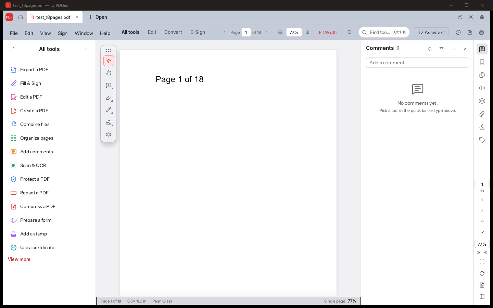
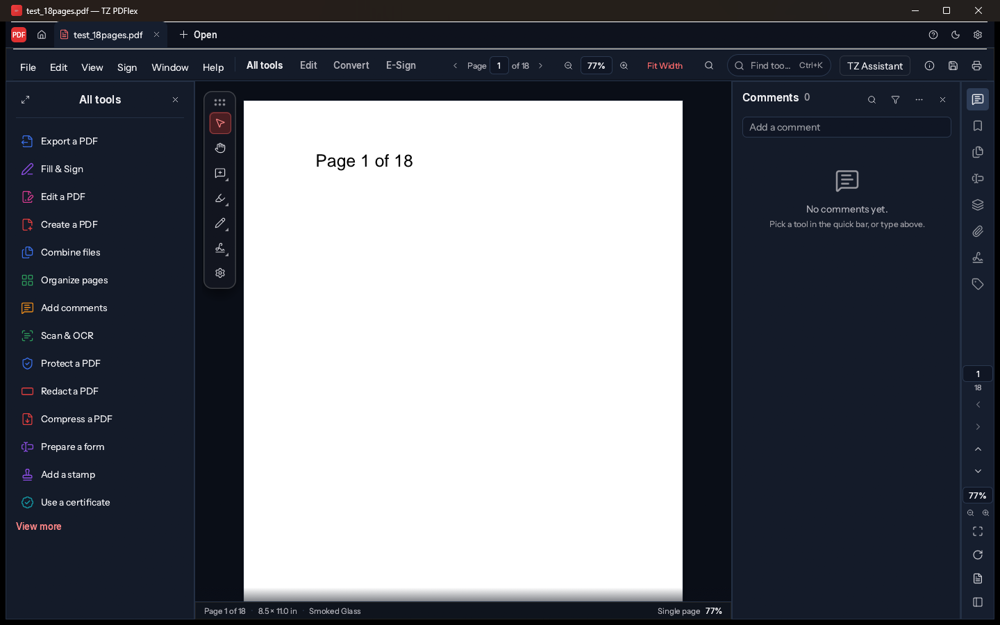

# 05. TZ PDFlex Guide

**TZ PDFlex** (`tz-pdflex.exe`) is the document inspection, annotation, AcroForm completion, text modification, and security redaction utility in the TZWorkQuint suite. It handles multi-page technical manuals, legal filings, and forms with fast vector rendering, zero-leak permanent redaction, and local execution.

*Figure 5.1: TZ PDFlex in Pearl Glass mode showing multi-page viewer, toolbar modes, and thumbnail navigation.*

---

## The First Five Minutes

1. **Open a PDF:**  
   Launch PDFlex from the Hub or drag any PDF into `bin\tz-pdflex.exe`. You can also open the sample document with `test-docs\test_18pages.pdf`.

2. **Navigate & Zoom:**  
   - Use the mouse wheel to scroll smoothly through pages.
   - Click the page indicator at the bottom to jump directly to page number `5`.
   - Click **Fit Width** in the top mode bar (<kbd>Ctrl</kbd>+<kbd>2</kbd>) to expand page width to the window, or **Fit Page** (<kbd>Ctrl</kbd>+<kbd>0</kbd>) to see full page margins.

3. **Find in Document:**  
   - Press <kbd>Ctrl</kbd>+<kbd>F</kbd> to open the in-page Find bar. Type a search term to highlight all occurrences and jump between matches.

4. **Annotate & Highlight:**  
   - Switch to the **Comment** tool on the top mode bar.
   - Select text to apply **Highlight**, **Underline**, or **Strikethrough**.
   - Click the **Sticky Note** icon to drop a threaded comment pin anywhere on the page.

5. **Fill Out Forms & Sign:**  
   - Switch to **Form** mode. Active AcroForm fields (text boxes, check boxes, radio buttons, dropdowns) highlight in light blue.
   - Click into fields to type data. Switch to **Sign** mode to insert a cryptographically verified signature.

6. **Permanent Redaction (Zero Leak Guarantee):**  
   - Switch to the **Redact** tool. Click **Mark Redaction Box** and drag over sensitive content (or use **Search & Redact** for automated keywords).
   - Click **Apply Redactions**. PDFlex permanently excises the underlying text and vectors from the PDF content stream and replaces them with solid black rectangles.
   - Save the file (<kbd>Ctrl</kbd>+<kbd>S</kbd>).

*Figure 5.2: TZ PDFlex in Smoked Glass dark mode.*

---

## Toolbars & Function Reference

### 1. Mode Bar & Primary Actions

| Command ID | Visible Label | Route / Location | Shortcut | Prerequisites | Expected Outcome |
|---|---|---|---|---|---|
| `file.open` | **Open…** | File Menu | <kbd>Ctrl</kbd>+<kbd>O</kbd> | PDFlex Open | Opens file dialog to load PDF. |
| `file.save` | **Save** | File Menu | <kbd>Ctrl</kbd>+<kbd>S</kbd> | Doc Loaded | Writes changes incrementally or compacted. |
| `file.saveAs` | **Save As…** | File Menu | <kbd>Ctrl</kbd>+<kbd>Shift</kbd>+<kbd>S</kbd>| Doc Loaded | Saves document to a new file path. |
| `view.fit_page` | **Fit Page** | Zoom Controls | <kbd>Ctrl</kbd>+<kbd>0</kbd> | Doc Loaded | Scales viewport so entire page fits in window. |
| `view.fit_width` | **Fit Width** | Zoom Controls | <kbd>Ctrl</kbd>+<kbd>2</kbd> | Doc Loaded | Scales page width to fill window width. |
| `view.zoom_in` | **Zoom In** | Zoom Controls | <kbd>Ctrl</kbd>+<kbd>+</kbd> | Doc Loaded | Increases zoom level by 25%. |
| `view.zoom_out` | **Zoom Out** | Zoom Controls | <kbd>Ctrl</kbd>+<kbd>-</kbd> | Doc Loaded | Decreases zoom level by 25%. |
| `doc.find` | **Find** | Navigation | <kbd>Ctrl</kbd>+<kbd>F</kbd> | Doc Loaded | Opens in-page text search bar. |
| `mode.view` | **Hand / Select**| Mode Bar | <kbd>V</kbd> | Doc Loaded | Default mode for reading and scrolling. |
| `mode.comment` | **Comment** | Mode Bar | <kbd>C</kbd> | Doc Loaded | Activates annotations: highlights, notes, shapes.|
| `mode.edit` | **Edit Text** | Mode Bar | <kbd>E</kbd> | Doc Loaded | Enables direct editing of text and inline images.|
| `mode.form` | **Form & Sign** | Mode Bar | <kbd>F</kbd> | Doc Loaded | Enables AcroForm input and signature fields. |
| `mode.redact` | **Redact** | Mode Bar | <kbd>R</kbd> | Doc Loaded | Activates permanent redaction tools. |
| `mode.organize` | **Organize Pages**| Sidebar | *None* | Doc Loaded | Reorder, delete, rotate, or extract pages. |

### 2. Redaction & Security Tools

| Command ID | Visible Label | Route / Location | Shortcut | Prerequisites | Expected Outcome |
|---|---|---|---|---|---|
| `redact_mark` | **Mark for Redaction**| Redact Mode Bar | *None* | Redact Mode | Draws candidate redaction box over text/images. |
| `redact_apply`| **Apply Redactions** | Redact Mode Bar | *None* | Marks Present | Permanently deletes covered bytes and text. |
| `redact_clear`| **Clear All Marks** | Redact Mode Bar | *None* | Marks Present | Removes unapplied candidate redaction boxes. |
| `doc_remove_hidden`| **Sanitize Document**| File › Sanitize | *None* | Doc Loaded | Strips metadata, attachments, hidden layers, XFA. |

---

## Verifying the Redacted Result

A critical feature of TZ PDFlex is that **redaction is irreversible and destructive at the binary level**:

1. Open a document containing sensitive text (e.g. `test_18pages.pdf`).
2. Switch to **Redact** mode and drag a rectangle over the word `Page`.
3. Notice the candidate mark displays with a red border and semi-transparent tint.
4. Click **Apply Redactions**. The dialog prompts for confirmation: *“Applying redactions permanently removes covered content and cannot be undone once saved.”*
5. Click **Apply**. The area becomes a solid opaque black rectangle.
6. Save the document to `redacted_output.pdf`.
7. **Verification Test:** Open `redacted_output.pdf` in any PDF reader (or extract text via CLI: `pdfcraft-cli run --script ...`).
8. Notice that selecting the black box yields **zero text**, and searching for `Page` returns **0 matches**. The glyphs and bounding boxes have been completely excised from the PDF content stream.

