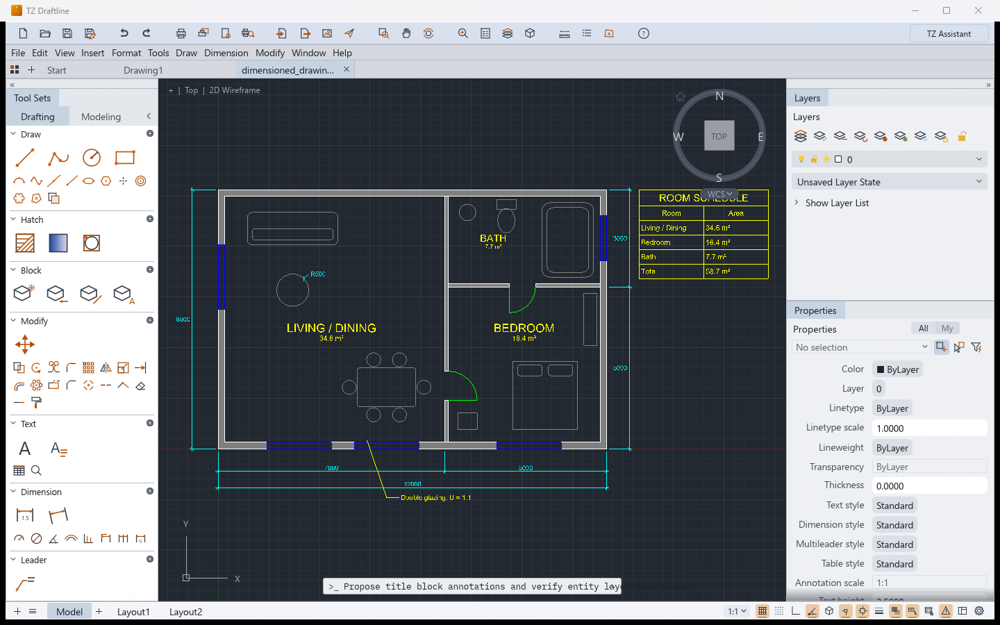
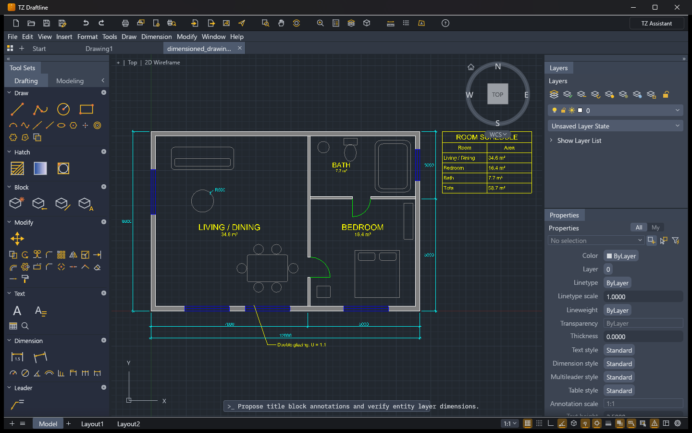

# 06. TZ Draftline Guide

**TZ Draftline** (`tz-draftline.exe`) is the dedicated 2D Computer-Aided Design (CAD), architectural drafting, and mechanical detailing application in the TZWorkQuint suite. It reads, modifies, and outputs industry-standard AutoCAD Drawing Exchange Format (`.dxf`) files with precision snapping, layer management, interactive command-line autocomplete, and real-time GPU rendering.

*Figure 6.1: TZ Draftline in Pearl Glass mode showing drawing viewport, toolbars, properties panel, and bottom command line.*

---

## The First Five Minutes

1. **Create or Open a Drawing:**  
   Launch Draftline from the Hub or run `bin\tz-draftline.exe`. Click **New Drawing** (<kbd>Ctrl</kbd>+<kbd>N</kbd>) to start with standard metric/imperial templates, or open `test-docs\dimensioned_drawing.dxf`.

2. **Navigate the Viewport:**  
   - **Pan:** Click and hold the mouse scroll wheel (middle button) and drag.
   - **Zoom:** Rotate the scroll wheel forward to zoom in, backward to zoom out.
   - **Zoom Extents:** Double-click the middle mouse button or type `Z` <kbd>Enter</kbd> `E` <kbd>Enter</kbd> to fit all drawing entities in the window.
   - **ViewCube:** Click the ViewCube corners or faces in the top right to orient views.

3. **Use the Interactive Command Line:**  
   At the bottom of the screen, the Command Line accepts standard CAD commands and single-letter aliases:
   - Type `L` and press <kbd>Enter</kbd> to start the **LINE** command. Click the canvas to place start and end points.
   - Type `C` and press <kbd>Enter</kbd> to start the **CIRCLE** command. Click for center, then type `25` and press <kbd>Enter</kbd> for radius.
   - Type `REC` and press <kbd>Enter</kbd> to draw a **RECTANGLE**.

4. **Object Snaps (O-Snaps):**  
   - As you move the crosshairs near existing entities, magnetic snap indicators appear:
     - Green Square: **Endpoint**
     - Green Triangle: **Midpoint**
     - Green Circle: **Center**
     - Green Perpendicular: **Perpendicular**
   - Press <kbd>F3</kbd> to toggle snaps on or off. Press <kbd>F8</kbd> to toggle **Ortho Mode** (locks lines to 0°/90°).

5. **Manage Layers & Properties:**  
   - In the right-hand **Layers** panel, click **New Layer**. Name it `Centerlines` and set color to Red.
   - Select any drawn entity and use the **Properties** inspector to assign it to a layer or override lineweight and linetype.

6. **Add Dimensions & Save DXF:**  
   - In the Dimension toolbar, click **Linear Dimension** (`DIMLINEAR`). Click two points, then click to position the dimension line.
   - Press <kbd>Ctrl</kbd>+<kbd>S</kbd> to save. The file opens natively in AutoCAD, LibreCAD, and commercial CNC/CAM viewers.

*Figure 6.2: TZ Draftline in Smoked Glass dark mode.*

---

## Command Line Aliases & Function Reference

Draftline provides full compatibility with standard industry CAD keyboard shortcuts:

| Command ID | Standard Alias | Visible Menu Label | Route / Toolbar | Shortcut | Purpose & Outcome |
|---|---|---|---|---|---|
| `new` | `QNEW` | **New Drawing…** | File Menu | <kbd>Ctrl</kbd>+<kbd>N</kbd> | Creates empty drawing with active template. |
| `open` | `OPEN` | **Open…** | File Menu | <kbd>Ctrl</kbd>+<kbd>O</kbd> | Opens existing DXF/DWG vector drawing. |
| `save` | `QSAVE` | **Save** | File Menu | <kbd>Ctrl</kbd>+<kbd>S</kbd> | Saves active drawing to disk. |
| `line` | `L` | **Line** | Draw Toolbar | *None* | Constructs continuous straight line segments. |
| `circle` | `C` | **Circle** | Draw Toolbar | *None* | Constructs circle via center & radius/diameter. |
| `rect` | `REC` | **Rectangle** | Draw Toolbar | *None* | Constructs closed polyline rectangle from two corners.|
| `arc` | `A` | **Arc** | Draw Toolbar | *None* | Constructs 3-point or start-center-end arc. |
| `polyline` | `PL` | **Polyline** | Draw Toolbar | *None* | Constructs connected 2D line/arc segments. |
| `move` | `M` | **Move** | Modify Toolbar | *None* | Displaces selected entities by displacement vector.|
| `copy` | `CP` / `CO` | **Copy** | Modify Toolbar | *None* | Clones selected entities to new coordinates. |
| `rotate` | `RO` | **Rotate** | Modify Toolbar | *None* | Rotates entities around a base point. |
| `trim` | `TR` | **Trim** | Modify Toolbar | *None* | Trims entity edges against bounding geometry. |
| `extend` | `EX` | **Extend** | Modify Toolbar | *None* | Extends line segments to meet boundary entity. |
| `erase` | `E` | **Erase** | Modify Toolbar | <kbd>Delete</kbd> | Deletes selected entities from the drawing. |
| `dimlinear` | `DLI` | **Linear Dimension**| Dimension | *None* | Measures horizontal/vertical distance between points.|
| `dimradial` | `DRA` | **Radius Dimension**| Dimension | *None* | Measures and labels radius of an arc or circle. |
| `layer` | `LA` | **Layer Manager** | View Menu | *None* | Opens dialog to create, freeze, and lock layers.|
| `ortho` | *None* | **Ortho Mode** | Status Bar | <kbd>F8</kbd> | Constrains cursor motion to perpendicular axes. |
| `osnap` | *None* | **Object Snap** | Status Bar | <kbd>F3</kbd> | Toggles geometric magnet snapping. |

---

## ViewCube & Coordinates Worked Example

1. Open `test-docs/dimensioned_drawing.dxf`.
2. Notice the drawing opens with entities grouped into layers: `Outline`, `Dimensions`, `Centerlines`.
3. In the right-hand **Layers** panel, click the **Eye icon** next to `Dimensions` to hide all dimension text and witness immediate uncluttered drawing geometry.
4. Draw an alignment hole:
   - Type `C` and press <kbd>Enter</kbd>.
   - Hover over the top-left circle until the green circle center snap appears. Click to lock the center.
   - Type `12.5` and press <kbd>Enter</kbd>. An inner concentric circle is created.
5. In the Properties panel, change its layer to `Outline`.
6. Press <kbd>Ctrl</kbd>+<kbd>S</kbd> to save the DXF.
7. Reopen in AutoCAD or inspection harness: the new circle entity is verified at exact coordinates with matching layer properties.

