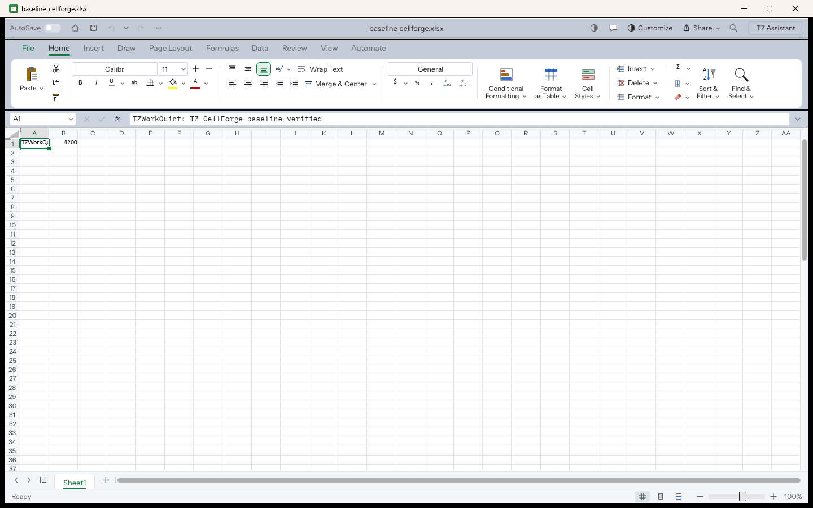
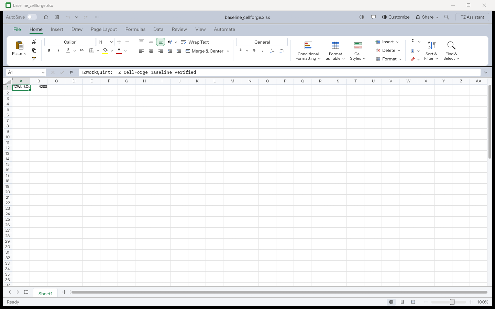
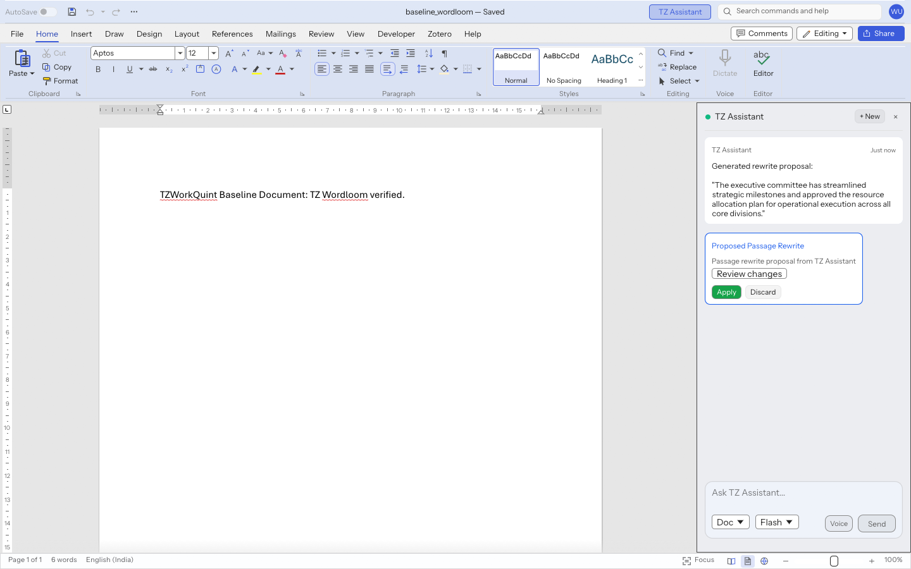
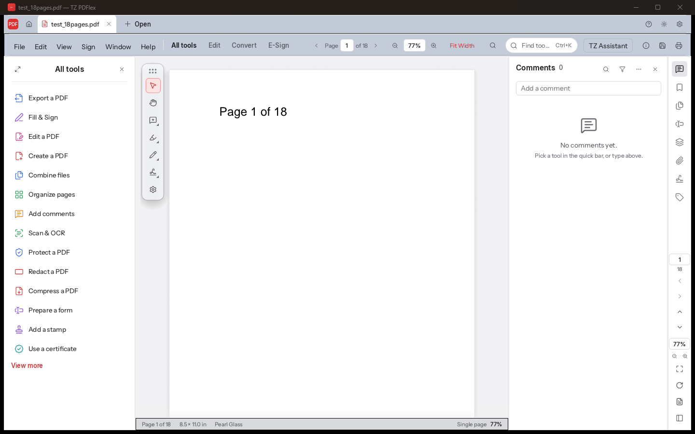
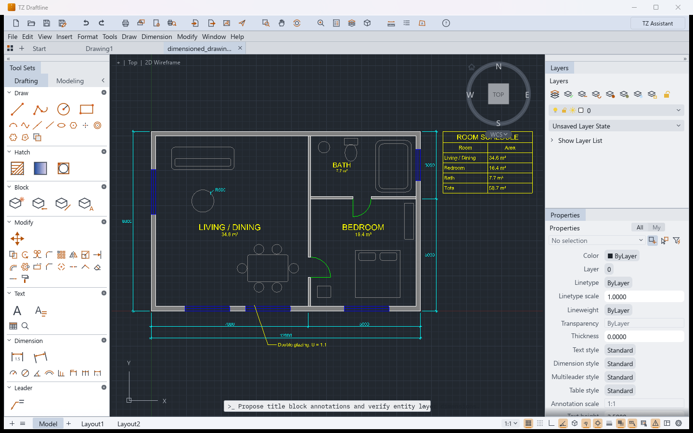
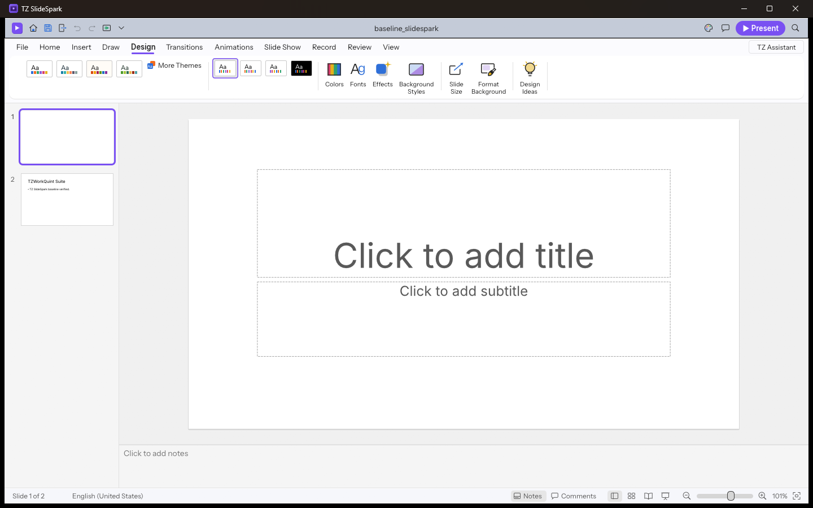

# 07. Using TZ Assistant

**TZ Assistant** is the integrated, privacy-focused artificial intelligence copilot available across all five TZWorkQuint editors (**Wordloom**, **CellForge**, **SlideSpark**, **PDFlex**, and **Draftline**). It is engineered from first principles in native Rust to provide context-aware document editing, formula synthesis, technical CAD modifications, and content generation while keeping your data under your complete sovereignty.

Unlike webview-based AI sidebars that silently stream document contents to external telemetry servers, TZ Assistant operates exclusively through a docked, native panel with transparent gateway routing, granular scope controls, and an explicit **Proposal & Review** workflow where no document changes occur without your approval.


*Figure 7.1: TZ Assistant docked panel in CellForge showing a formula proposal with interactive Diff, Apply, Discard, and Undo controls.*

---

## 1. Opening & Closing TZ Assistant

Across all five editors, TZ Assistant lives in a dedicated, collapsible right-hand dock designed to preserve your primary workspace.

### Dock Placement and Workspace Clearance
- **Dock Width:** Fixed at a clean 320 px (or responsive 300–360 px depending on window size).
- **Zero Viewport Obstruction:** Opening the dock automatically resizes the active document viewport:
  - In **Wordloom**: The horizontal and vertical rulers adjust their zero-points, and paper margins remain fully visible.
  - In **CellForge**: The formula bar and column headers clamp cleanly to the dock edge; cell selection is never obscured.
  - In **SlideSpark**: The slide thumbnail strip on the left and slide canvas in the center re-center smoothly without overlapping slide boundaries.
  - In **PDFlex**: The PDF page display and annotation floating toolbar remain fully accessible.
  - In **Draftline**: The CAD viewport contracts cleanly, leaving the bottom command-line input and top coordinate display completely unobstructed.
- **Tested Resolutions:** The dock operates smoothly at compact resolutions down to **1040 × 760**, as well as standard 1440 × 900, 1920 × 1080, and high-DPI displays (125%, 150%).

### Launch Points in Each Editor
To toggle the Assistant open or closed:
- Click the **`✨ TZ Assistant`** button in the top window title bar (present in all five apps).
- Or use the keyboard shortcut <kbd>Ctrl</kbd>+<kbd>Alt</kbd>+<kbd>A</kbd>.
- To close the dock, click the **Close (✕)** button in the top-right corner of the Assistant panel or press <kbd>Esc</kbd> when the composer is focused.

---

## 2. Reaching & Configuring the TZ AI Gateway

TZWorkQuint connects to AI models through the **TZ AI Gateway**, an offline-first modular proxy client supporting local LLM engines (Ollama, LM Studio, LocalAI) and cloud API providers (Google Gemini, OpenAI, Anthropic).

### Exact Route to AI Gateway Settings in Each App

| Application | Navigation Route | Shortcut | Configuration Scope |
|---|---|---|---|
| **TZ Wordloom** | **File** › **Options** › **TZ AI Gateway** | <kbd>Ctrl</kbd>+<kbd>,</kbd> | Document completion, prose rewrites, style analysis. |
| **TZ CellForge** | **File** › **Options** › **TZ AI Gateway** | <kbd>Ctrl</kbd>+<kbd>,</kbd> | Formula synthesis, tabular cleaning, trend forecasts. |
| **TZ SlideSpark** | **File** › **Preferences** › **TZ AI Gateway** | <kbd>Ctrl</kbd>+<kbd>,</kbd> | Slide outline generation, bullet refinement, deck summaries. |
| **TZ PDFlex** | **File** › **Preferences** › **AI Gateway** | <kbd>Ctrl</kbd>+<kbd>,</kbd> | Document summarization, field autofill, annotation proposals. |
| **TZ Draftline** | **Settings** › **TZ AI Gateway** | <kbd>Ctrl</kbd>+<kbd>,</kbd> | Geometry generation, layer reorganization, parameter math. |

Alternatively, in any open Assistant dock, click the **Gear (⚙)** icon in the Assistant header to jump directly into the Gateway settings dialog.


*Figure 7.2: TZ AI Gateway configuration dialog showing provider selection, endpoint URL, credentials, and connection diagnostics.*

---

## 3. Provider Configuration & Diagnostics

The Gateway supports five provider modes:

```
┌────────────────────────────────────────────────────────────────────────┐
│                        TZ AI Gateway Providers                         │
├──────────────────┬───────────────────┬─────────────────────────────────┤
│ Provider Mode    │ Default Endpoint  │ Authentication / Security       │
├──────────────────┼───────────────────┼─────────────────────────────────┤
│ Local Mock       │ internal://mock   │ Offline testing; zero network   │
│ LM Studio        │ http://localhost:1234/v1 │ Local OpenAI-compatible server │
│ Ollama           │ http://localhost:11434/v1 │ Local llama3/qwen2/mistral    │
│ Google Gemini    │ https://generativelanguage.googleapis.com │ API Key (Encrypted DPAPI)       │
│ OpenAI           │ https://api.openai.com/v1 │ API Key (Encrypted DPAPI)       │
└──────────────────┴───────────────────┴─────────────────────────────────┘
```

### Setup Steps
1. **Choose Provider:** In the **Provider** dropdown, select your preferred engine. For 100% offline document privacy, select **Ollama** or **LM Studio**.
2. **Endpoint URL:** For local servers, verify the host port (e.g. `http://localhost:11434/v1` for Ollama). For cloud providers, the official HTTPS endpoint is pre-filled.
3. **API Key / Credentials:** Enter your secret key. Keys are encrypted at rest using the Windows Data Protection API (DPAPI) in `%APPDATA%\<app>\data\credentials.dat`.
4. **Model Selection:** Choose your target model name (e.g., `llama3.2:latest`, `gemini-1.5-pro`, `gpt-4o`).
5. **Connection Test:** Click **Test Connection**.
   - **Success (Green):** Displays `Connection Verified (RTT: 42ms)`.
   - **Error - Connection Refused (Red):** Local server is not running on the specified port.
   - **Error - Unauthorized 401 (Red):** The provided API key is invalid or expired.
   - **Error - Model Not Found 404 (Red):** The requested model tag is not pulled or available.

---

## 4. Chat Interactions & Context Scoping

The Assistant dock provides a clean, single-thread conversation container modeled on modern conversational simplicity.


*Figure 7.3: Assistant composer focused, showing context scope tag and microphone voice toggle.*

### Scoped Document Context
At the top of the composer, a **Context Pill** indicates what portion of your document is attached to the prompt:
- **`Scope: Full Document`**: Passes the entire document structure (capped at safe token windows).
- **`Scope: Selection Only`**: Attaches only the currently highlighted paragraph, selected table cells, active slide, or CAD entity selection.
- **`Scope: Current View`**: Attaches visible pages, active sheet, or current CAD viewport layers.

To change scope, click the context pill and choose your desired boundary. This guarantees you never expose sensitive background data outside your intended task.

### Composer Actions
- **Send Message:** Press <kbd>Enter</kbd> (or click the arrow button). Use <kbd>Shift</kbd>+<kbd>Enter</kbd> for multi-line inputs.
- **Stop Response:** While a response is streaming, the Send button transforms into a red **Stop (■)** button. Clicking it halts token generation immediately.
- **New Conversation:** Click the **`+` (New Chat)** icon in the Assistant header to reset the conversation thread.

---

## 5. Voice Input & Speech-to-Text

For hands-free operation, TZ Assistant includes integrated voice dictation:
1. Click the **Microphone (🎤)** button in the bottom-right corner of the composer.
2. Windows will display the standard microphone permission notification on first use.
3. While listening, the microphone icon pulses red with an active audio level meter.
4. Speak your command naturally (e.g. *"Format this column as currency and calculate the 15 percent tax in column E"*).
5. When you pause or click the microphone again, the speech is transcribed directly into the editable text composer.
6. **Review and Edit:** The transcript is placed in the composer *without* automatically submitting, giving you the opportunity to review, correct terms, or append instructions before pressing <kbd>Enter</kbd>.
7. **Offline Fallback:** If no microphone is detected or audio input fails, the composer displays a subtle notification and returns focus to standard keyboard input without interrupting the session.

---

## 6. The Proposal & Review Workflow

TZWorkQuint strictly avoids destructive automatic edits. Whenever the Assistant suggests changes to your document, it produces a structured **Proposal Card** containing an interactive diff:

```
┌─────────────────────────────────────────────────────────┐
│  ✨ Proposal: Update Column E Formulas                 │
├─────────────────────────────────────────────────────────┤
│  Original:                                              │
│  - E2: =C2 * 0.10                                       │
│  Proposed:                                              │
│  + E2: =C2 * $K$1                                       │
│  + E3: =C3 * $K$1                                       │
│  + E4: =C4 * $K$1                                       │
├─────────────────────────────────────────────────────────┤
│  [ Apply Changes ]    [ Discard ]    [ View Full Diff ] │
└─────────────────────────────────────────────────────────┘
```

- **Diff Highlighting:** Deletions are highlighted with soft red backgrounds and strikethroughs; additions are highlighted in crisp light green.
- **Apply Changes:** Click **Apply** to execute the proposal. The document state transitions immediately, and an undo snapshot is committed to the application history stack.
- **Discard:** Click **Discard** to reject the proposal. The document remains completely untouched.
- **Instant Undo:** If you apply a proposal and later decide to revert it, press <kbd>Ctrl</kbd>+<kbd>Z</kbd> (or click **Edit › Undo** in the main application ribbon). The entire batch of proposed modifications is reversed in a single step.

---

## 7. Five Worked Practical Examples

### Example 1: TZ Wordloom — Executive Briefing Rewrite
- **Original Document:** A 3-paragraph executive summary in `test-docs/sample_briefing.docx`.
- **User Action:** Select paragraph 2. Click the Assistant button (<kbd>Ctrl</kbd>+<kbd>Alt</kbd>+<kbd>A</kbd>). Notice the context pill automatically switches to `Scope: Selection`.
- **Prompt:**
  ```
  Make this executive briefing more concise, punchy, and impactful for a board presentation. Use active voice.
  ```
- **Assistant Response:** Returns a Proposal Card with side-by-side prose comparison, cutting 45 unnecessary passive words and highlighting strong verb substitutions.
- **Outcome:** Click **Apply**. The selected paragraph updates cleanly in the document with original paragraph formatting (Aptos font, 1.15 line spacing) intact.


*Figure 7.4: Wordloom text rewrite proposal with side-by-side diff review.*

---

### Example 2: TZ CellForge — Multi-Condition Formula Synthesis
- **Original Document:** `test-docs/sales_q3.xlsx` containing sales records in columns A through D.
- **User Action:** Click cell `E2`. Open TZ Assistant.
- **Prompt:**
  ```
  Propose a formula to sum column D if column A equals "West" and column B is greater than 1000.
  ```
- **Assistant Response:** Proposes `=SUMIFS(D2:D50, A2:A50, "West", B2:B50, ">1000")`. The proposal card displays the target cell, formula string, and the simulated calculated result (`$142,500.00`).
- **Outcome:** Click **Apply**. Cell `E2` receives the formula and immediately computes the result. Cell dependencies and PivotTables recalculate automatically.

---

### Example 3: TZ PDFlex — Contract Clause Annotation
- **Original Document:** `test-docs/master_agreement.pdf`.
- **User Action:** Navigate to Page 4, Section 6.2 (Indemnification). Open TZ Assistant.
- **Prompt:**
  ```
  Highlight Section 6.2 and attach a yellow sticky note saying: "Requires legal review regarding liability caps before signing."
  ```
- **Assistant Response:** Assistant computes exact bounding box coordinates `[72, 450, 540, 510]` and proposes a Highlight annotation combined with an AcroForm Text Note.
- **Outcome:** Click **Apply**. The highlighted region appears in the PDF viewport with the sticky note placed neatly in the right margin. Saving the document preserves the annotation in standard PDF 1.7 format.


*Figure 7.5: PDFlex annotation proposal placing sticky note and text highlight.*

---

### Example 4: TZ Draftline — CAD Entity Geometry Modification
- **Original Document:** `test-docs/mechanical_plate.dxf`.
- **User Action:** Select the mounting hole circle entity at coordinate `(100.0, 150.0)`.
- **Prompt:**
  ```
  Resize this circle radius from 10.0mm to 15.0mm and move it to layer "MOUNTING_HOLES".
  ```
- **Assistant Response:** Proposes a geometry transformation delta:
  - Entity ID: `CIRC_04`
  - Radius: `10.0 -> 15.0`
  - Layer: `0 -> MOUNTING_HOLES`
- **Outcome:** Click **Apply**. In the CAD canvas, the hole enlarges to exactly 15.0 mm radius, and its display color updates to match the layer color of `MOUNTING_HOLES`. The action appears in the CAD command history.


*Figure 7.6: Draftline CAD entity modification proposal.*

---

### Example 5: TZ SlideSpark — Slide Text & Bullet Revision
- **Original Document:** `test-docs/product_launch.pptx`.
- **User Action:** Open slide 4 ("Key Architecture Milestones"). Select the central bullet content box.
- **Prompt:**
  ```
  Rephrase these technical bullet points into active, benefit-driven customer milestones.
  ```
- **Assistant Response:** Generates a structured slide content proposal showing four revised bullet points with concise headings and active verbs.
- **Outcome:** Click **Apply**. The slide text updates instantly. Font size auto-fitting and bullet indentation are preserved without shifting other graphics on the slide.


*Figure 7.7: SlideSpark slide revision proposal updating bullet points.*

