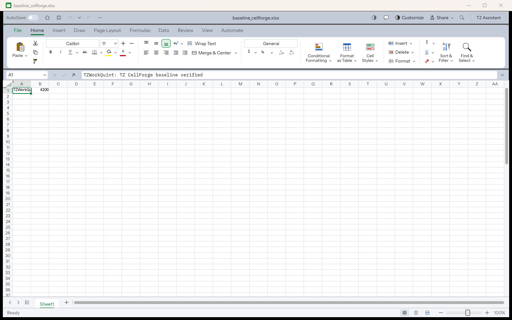
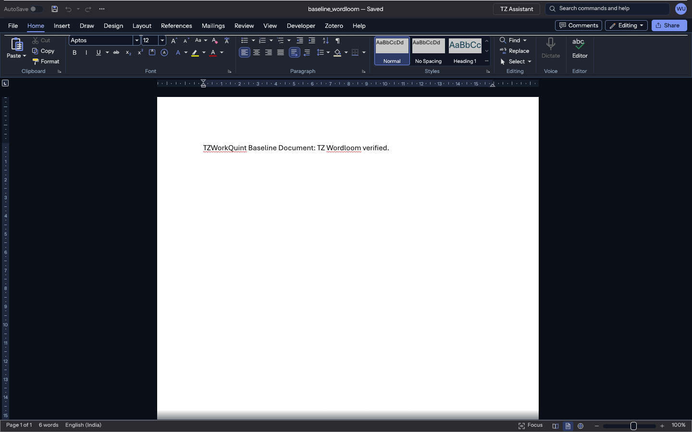
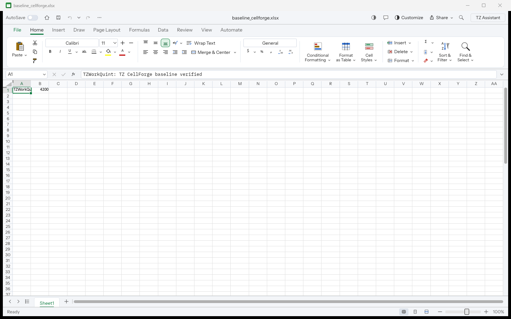

# 08. Customization, Themes & Workspaces

TZWorkQuint features a native, GPU-accelerated visual architecture engineered specifically for Windows 10 and 11. It blends high-end optical materials ("liquid glass") with rock-solid legibility, ergonomic light and dark palettes, and deeply customizable workspace layouts.

Every customization setting is persisted locally in user application state (`%APPDATA%\<app>\data\app.ron`), ensuring your workspace preferences remain stable across system reboots, updates, and offline sessions.


*Figure 8.1: Optical material rendering in TZ CellForge (Pearl Glass mode), showing frosted header translucent blending and high-contrast formula bar.*

---

## 1. Optical Material Options

TZWorkQuint offers three distinct rendering modes across the Hub and all five editors:

| Material Mode | Optical Character | Visual Treatment | Best Used For |
|---|---|---|---|
| **Pearl Glass** | High-clarity light frosting | Soft daylight translucency with a calibrated top specular rim (`rgba(255, 255, 255, 0.70)`) and subtle drop-shadows. | Daytime work, high-ambient office lighting, multi-window desktop aesthetics. |
| **Smoked Glass** | Deep dark translucent slate | Charcoal/slate dark backing with optical depth and a refined top rim highlight (`rgba(255, 255, 255, 0.12)`). | Evening work, dark room environments, minimizing eye fatigue during long sessions. |
| **Glass Off (Solid)** | Zero transparency / solid opaque | 100% opaque solid background surfaces with crisp 1 px borders and zero alpha blending. | High-contrast accessibility, remote desktop (RDP) sessions, low-power laptop profiles. |


*Figure 8.2: Smoked Glass dark mode in TZ Wordloom with high-contrast document paper and refined translucent ribbon chrome.*

### Changing Optical Material & Theme
1. **Via Window Menu:**
   - In **Hub**: Click the **Gear (⚙)** icon in the top header.
   - In **Wordloom / CellForge / SlideSpark / PDFlex**: Go to **File** › **Options** (or **Preferences**) › **Appearance**.
   - In **Draftline**: Go to **Settings** › **Visual Styles & Materials**.
2. **Selecting Material:** Choose between **System Auto**, **Pearl Glass (Light)**, **Smoked Glass (Dark)**, or **Solid (Glass Off)**.
3. **Instant Switching:** The GPU rendering pipeline rebuilds egui shader meshes immediately without requiring an application restart.


*Figure 8.3: Solid (Glass Off) rendering in CellForge showing completely opaque surfaces for maximum contrast.*

---

## 2. Reduced Motion & Accessibility

For users who experience discomfort with animated transitions, or who operate under strict accessibility guidelines (WCAG 2.3.3):

1. **Reduced Motion Toggle:** Located in **Preferences › Appearance › Reduced Motion**.
2. **System Synchronization:** By default, TZWorkQuint queries the Windows system preference (`Windows Settings › Accessibility › Visual Effects › Animation Effects`). If animations are disabled in Windows, TZWorkQuint automatically switches to zero-motion transitions.
3. **Behavioral Impact:**
   - Dock slide-out transitions (such as opening TZ Assistant or the Draftline Layer Manager) become instant 1-frame snaps.
   - Smooth canvas zooming and viewport pan easing switch to immediate point-to-point redraws.
   - Modal dialog fade-ins and button hover pulse animations are disabled.

---

## 3. Workspace Layout Presets

Every TZWorkQuint editor supports three tailored workspace layouts designed for different phases of work:

```
┌────────────────────────────────────────────────────────────────────────┐
│                        Workspace Layout Presets                        │
├────────────────────┬─────────────────────────────┬─────────────────────┤
│ Preset Name        │ Active UI Elements          │ Target Task         │
├────────────────────┼─────────────────────────────┼─────────────────────┤
│ Classic            │ Full ribbon tabs, formula   │ Daily production,   │
│                    │ bar / rulers, full status   │ comprehensive tool  │
│                    │ bar, standard docks.        │ discovery.          │
├────────────────────┼─────────────────────────────┼─────────────────────┤
│ Review & Analysis  │ Compact ribbon, prominent   │ Editorial critique, │
│                    │ revisions pane, comments,   │ audit verification, │
│                    │ side-by-side proposal dock. │ client proofing.    │
├────────────────────┼─────────────────────────────┼─────────────────────┤
│ Focus              │ Auto-hidden ribbon, ruler   │ Deep composition,   │
│                    │ collapsed, maximum canvas   │ distraction-free    │
│                    │ area, minimal status bar.   │ drafting.           │
└────────────────────┴─────────────────────────────┴─────────────────────┘
```

### Switching Presets
- Open **View** › **Workspace Preset** from the main ribbon or menu bar.
- Choose **Classic**, **Review**, or **Focus**.
- Or use the keyboard shortcut <kbd>Ctrl</kbd>+<kbd>Alt</kbd>+<kbd>1</kbd> (Classic), <kbd>Ctrl</kbd>+<kbd>Alt</kbd>+<kbd>2</kbd> (Review), or <kbd>Ctrl</kbd>+<kbd>Alt</kbd>+<kbd>3</kbd> (Focus).

---

## 4. Ribbon & Toolbar Customization

### Minimizing the Ribbon
If you need extra vertical room on compact laptops or 1040 × 760 screens:
- Double-click any active ribbon tab label (e.g. **Home**, **Insert**, **View**).
- Or press <kbd>Ctrl</kbd>+<kbd>F1</kbd>.
- The ribbon collapses down to a single compact tab bar. Clicking any tab temporarily drops down its tool group; moving focus back into the canvas auto-tucks the ribbon away.

### Quick Access Toolbar (QAT)
In Wordloom, CellForge, and SlideSpark, a customizable Quick Access Toolbar sits in the upper title bar:
- Right-click any command in the ribbon (e.g. **PivotTable**, **Track Changes**, **Presenter View**) and select **Add to Quick Access Toolbar**.
- The command icon is pinned to the title bar, accessible at all times regardless of which ribbon tab is currently active.
- To remove an action, right-click its pinned icon and select **Remove from Quick Access Toolbar**.

---

## 5. Settings Persistence & Multi-Monitor Support

### Configuration File Locations
All visual customizations, window geometry, recent document histories, and gateway endpoints are stored in human-readable RON (Rusty Object Notation) configuration files:

- **Hub Configuration:** `%APPDATA%\tz.workquint.launcher\data\app.ron`
- **Wordloom:** `%APPDATA%\tz.wordloom\data\settings.ron`
- **CellForge:** `%APPDATA%\tz.cellforge\data\settings.ron`
- **SlideSpark:** `%APPDATA%\tz.slidespark\data\settings.ron`
- **PDFlex:** `%APPDATA%\tz.pdflex\data\settings.ron`
- **Draftline:** `%APPDATA%\tz.draftline\data\settings.ron`

### Multi-Monitor DPI Scaling
TZWorkQuint monitors per-monitor DPI changes in real time:
- Moving an editor window between a 100% standard monitor (1080p) and a 150% high-DPI laptop screen triggers immediate vector font and widget scaling.
- UI elements, icons, and text maintain razor-sharp physical proportions without blurring or bitmap stretching.
- Window coordinates and dock states are saved on exit and restored to the exact target monitor on subsequent launches.

